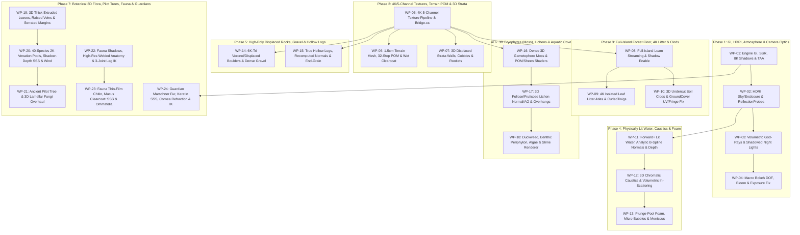

# Vivarium Photorealistic Rendering Overhaul — Master Plan for Flash-Level Agent Execution

> [!IMPORTANT]
> **Mandate & Operating Constraints:**
> 1. **Fidelity Is Absolute:** Every iGPU (Radeon 860M) compromise in geometry tessellation, texture resolution, shadow map resolution, global illumination, subsurface scattering, and shader complexity is lifted.
> 2. **Simulation Authority Preserved:** All changes remain strictly on the presentation/geometry/shader/asset side (`game/` and `src/Vivarium.Sim/Geometry/`). Simulation state digests (`VivariumWorld`) must remain deterministic.
> 3. **Flash-Agent Packet Sizing:** Historical orchestrator evidence ([ledger.md](file:///e:/Vivarium/.claude/ledger.md#L107)) proves that worker agents fail or refuse tasks touching $>6$ files or $>2$ subsystems. Every Work Packet (`WP-01` to `WP-24`) below is scoped to $\le 6$ files with explicit line numbers, exact C#/GLSL specifications, and a deterministic verification gate.

---

## 1. Visual & Code-Level Root-Cause Diagnosis

````carousel

<!-- slide -->

<!-- slide -->

<!-- slide -->

<!-- slide -->

<!-- slide -->

````

### Summary of Technical Root Causes Audited Across the Codebase

| Subsystem | Audited Defect | Exact Code Location | Visual Consequence |
| :--- | :--- | :--- | :--- |
| **GI, SSR & Shadows** | `SdfgiEnabled = false`, `SsrEnabled = false`, `GlowEnabled = false`, no `VoxelGI` or `ReflectionProbe`s; shadow atlas is $2048/4096$ over $28\text{ m}$ with `ShadowBias = 0.035f` ($3.5\text{ cm}$!) and no split blending. | [`EnvironmentRig._Ready`](file:///e:/Vivarium/game/Render/EnvironmentRig.cs#L135-L245) | Zero multi-bounce indirect radiosity; zero local reflections on wet soil, leaves, or water; $3.5\text{ cm}$ shadow detachment ("peter-panning") on all stems, litter, and pebbles. |
| **Lighting & Sky IBL** | [`canopy_sky.gdshader`](file:///e:/Vivarium/game/Shaders/canopy_sky.gdshader#L5-L7) outputs `vec3(0.0)` for camera rays (`!AT_CUBEMAP_PASS`) and a $0.25\text{ Hz}$ throttled 2D value-noise ramp ($\le 1.0$ LDR) for the cubemap. [`ApplyDayNight`](file:///e:/Vivarium/game/Render/EnvironmentRig.cs#L291-L320) washes out 65% of sun color with flat LED tint, uses an unshadowed `_fill` light, and sets 65% of ambient light to a constant flat color. | [`EnvironmentRig.cs`](file:///e:/Vivarium/game/Render/EnvironmentRig.cs#L48-L56), [`forest_canopy_radiance.gdshaderinc`](file:///e:/Vivarium/game/Shaders/forest_canopy_radiance.gdshaderinc#L1-L38) | Black background corrupts viewport auto-exposure histogram; specular highlights on water and leaves have no HDR solar/canopy dynamic range; unshadowed `_fill` light leaks through solid terrain and logs. |
| **Atmosphere & Camera** | [`EnvironmentRig._Process`](file:///e:/Vivarium/game/Render/EnvironmentRig.cs#L347-L351) overwrites `Env.FogEnabled = _underwater > .001f` every frame, killing above-water haze. `DofBlurNearEnabled` and `DofBlurFarEnabled` are disabled. | [`EnvironmentRig.cs`](file:///e:/Vivarium/game/Render/EnvironmentRig.cs#L125-L166), [`CameraRig.cs`](file:///e:/Vivarium/game/Camera/CameraRig.cs#L41) | Above-water depth fog is dead code; no volumetric Tyndall god-rays; infinite pinhole focus from $5\text{ mm}$ to $250\text{ m}$ destroys miniature macro scale perception. |
| **Water Rendering** | Both [`water_stream.gdshader`](file:///e:/Vivarium/game/Shaders/water_stream.gdshader#L4) and [`surface_fluid.gdshader`](file:///e:/Vivarium/game/Shaders/surface_fluid.gdshader#L2) use `render_mode unshaded`. [`surface_fluid.gdshader`](file:///e:/Vivarium/game/Shaders/surface_fluid.gdshader#L105) computes normals via `cross(dFdx(world_position), dFdy(world_position))`. [`water_stream.gdshader`](file:///e:/Vivarium/game/Shaders/water_stream.gdshader#L67) clamps depth path to $0.15\text{ m}$. [`mobile_water_optics.gdshaderinc`](file:///e:/Vivarium/game/Shaders/mobile_water_optics.gdshaderinc#L18) adds a $+0.055$ green reflection floor. | [`water_stream.gdshader`](file:///e:/Vivarium/game/Shaders/water_stream.gdshader#L1-L88), [`surface_fluid.gdshader`](file:///e:/Vivarium/game/Shaders/surface_fluid.gdshader#L105-L142) | Water receives **zero sun GGX specular glints** and **zero cast shadows** from trees/rocks; dynamic streams show hard triangular facets; deep ponds cap absorption at $15\text{ cm}$ and read as opaque olive plastic. |
| **Texture Pipeline** | All 7 core surface sets in [`Bridge.Surfaces`](file:///e:/Vivarium/game/App/Bridge.cs#L159-L163) are $1024\times 1024$ 8-bit JPGs re-compressed at `lossy_quality=0.7` BPTC. **Zero Height/Displacement or AO maps exist.** `LichenThallus.png.import` has `mipmaps/generate=false`. | [`Bridge.cs`](file:///e:/Vivarium/game/App/Bridge.cs#L142-L163), `game/Textures/*.import` | Blocky 8×8 JPEG DCT artifacts in normal maps at macro range; shaders fake height and AO from RGB albedo luminance (`dot(rgb, vec3(0.333))`), inverting dark wet peaks and pale dusty crevices. |
| **Terrain & Strata** | [`TerrainMesh.BuildTop`](file:///e:/Vivarium/src/Vivarium.Sim/Geometry/TerrainMesh.cs#L25-L57) subdivides $12.5\text{ cm}$ planar triangles by $2\times$ using linear `hf.Height(p)` with no sub-cell curvature and no vertex tangents. [`terrain.gdshader`](file:///e:/Vivarium/game/Shaders/terrain.gdshader#L20-L34) declares `damp_*` and `leaf_*` samplers and **never samples them**. [`TerrainMesh.BuildWalls`](file:///e:/Vivarium/src/Vivarium.Sim/Geometry/TerrainMesh.cs#L154-L161) emits 1 flat quad per stratum layer. | [`TerrainMesh.cs`](file:///e:/Vivarium/src/Vivarium.Sim/Geometry/TerrainMesh.cs#L17-L175), [`terrain.gdshader`](file:///e:/Vivarium/game/Shaders/terrain.gdshader#L170-L350), [`strata.gdshader`](file:///e:/Vivarium/game/Shaders/strata.gdshader#L1-L135) | Flat planar terrain facets with zero POM or vertex displacement; soil albedo clamped to `0.18`; blurry $25\text{ cm}$ contact AO blobs; razor-flat 2D strata walls with painted 2D lines for roots and cracks. |
| **Forest Floor & Litter** | [`LoamSurfaceDetailRenderer`](file:///e:/Vivarium/game/Render/LoamSurfaceDetailRenderer.cs#L48-L57) only covers a $6\text{ m}\times 6\text{ m}$ window around the camera. [`LoamLitterBuilder`](file:///e:/Vivarium/game/App/LoamLitterBuilder.cs#L25-L33) crops $26\times 42$ texel rectangles ($\sim 104\times 168\text{ px}$ in 4K) out of a ground scan (`ScatteredLeaves007`). [`LoamAggregateBuilder`](file:///e:/Vivarium/game/App/LoamAggregateBuilder.cs#L96-L145) builds 7–10 sided pyramids with no normal map (`loam_aggregate.gdshader`). [`AmbientGroundCoverRenderer`](file:///e:/Vivarium/game/Render/AmbientGroundCoverRenderer.cs#L265-L320) leaves `UV=(0,0)` on all blades/leaves, and [`BankFringe.cs`](file:///e:/Vivarium/game/Render/AmbientGroundCoverRenderer.BankFringe.cs#L21-L55) is never called. | [`LoamSurfaceDetailRenderer.cs`](file:///e:/Vivarium/game/Render/LoamSurfaceDetailRenderer.cs), [`LoamLitterBuilder.cs`](file:///e:/Vivarium/game/App/LoamLitterBuilder.cs), [`AmbientGroundCoverRenderer.cs`](file:///e:/Vivarium/game/Render/AmbientGroundCoverRenderer.cs) | Hard $3\text{ m}$ litter cutoff; blurry low-res clipped leaf cards; un-textured 4-sided box twigs; un-normal-mapped pyramid dirt clods; broken venation in `ground_cover.gdshader` due to `UV=(0,0)`. |
| **Props (Rocks, Logs, Gravel)** | [`RockSurfaceProfile.Create`](file:///e:/Vivarium/src/Vivarium.Sim/Geometry/RockSurfaceProfile.cs#L22-L72) & [`PropMeshes.Rock`](file:///e:/Vivarium/src/Vivarium.Sim/Geometry/PropMeshes.cs#L21-L44) build 6–8 sided prisms (84–112 flat-shaded triangles with unshared vertices and random triangle brightness). [`PropMeshes.Log`](file:///e:/Vivarium/src/Vivarium.Sim/Geometry/PropMeshes.cs#L406) displaces vertices without recomputing normals, uses a 3-ring dimple for hollow ends, and [`log.gdshader`](file:///e:/Vivarium/game/Shaders/log.gdshader#L29-L41) never writes `NORMAL` when `cap > 0.5`. | [`RockSurfaceProfile.cs`](file:///e:/Vivarium/src/Vivarium.Sim/Geometry/RockSurfaceProfile.cs), [`PropMeshes.cs`](file:///e:/Vivarium/src/Vivarium.Sim/Geometry/PropMeshes.cs), [`rock.gdshader`](file:///e:/Vivarium/game/Shaders/rock.gdshader), [`log.gdshader`](file:///e:/Vivarium/game/Shaders/log.gdshader) | Rocks look like Origami/Superhot faceted crystals; log bark swells have cylindrical normals; log end-caps and splinters have zero normal mapping; sparse gravel pebbles (`140/m²`) cast no shadows. |
| **Coverage (Moss, Lichen, Aquatic)** | [`CoverageRenderer`](file:///e:/Vivarium/game/Render/CoverageRenderer.cs#L489) sets `CastShadow = Off`, drops triangles with `maxY - minY > 0.03` on logs/terrain ([L910](file:///e:/Vivarium/game/Render/CoverageRenderer.cs#L910)), and gates [`AppendMossGrowthNucleus`](file:///e:/Vivarium/game/Render/CoverageRenderer.cs#L967) behind `mossGrowthStrength >= 4` (default is `1`). Lichen (`u_pattern >= 0.5` in [`coverage_mat.gdshader`](file:///e:/Vivarium/game/Shaders/coverage_mat.gdshader#L118-L124)) leaves `bump = vec3(0.0)` and `ao = 1.0`. Aquatic coverage layers (`SurfaceFloat`, `AlgaeBed`, `AlgaeFloat`) have **no renderer at all**. | [`CoverageRenderer.cs`](file:///e:/Vivarium/game/Render/CoverageRenderer.cs), [`CoverageRenderer.MossGrowth.cs`](file:///e:/Vivarium/game/Render/CoverageRenderer.MossGrowth.cs), [`coverage_mat.gdshader`](file:///e:/Vivarium/game/Shaders/coverage_mat.gdshader) | Moss reads as a smooth floating 2D rubber sheet; lichen is completely flat-shaded; duckweed, benthic periphyton, and filamentous algae exist in simulation but are invisible. |
| **Flora & Pilot Tree** | Only 4 of 40+ species use [`FloraVisualProfile`](file:///e:/Vivarium/game/Render/FloraVisualProfile.cs#L50-L59). [`LeafMaterialBaker.BakeVeins`](file:///e:/Vivarium/game/App/LeafMaterialBaker.cs#L123-L176) draws 7 straight Gaussian lines. [`Broadleaf`](file:///e:/Vivarium/src/Vivarium.Sim/Geometry/Form/Broadleaf.cs#L184-L253), [`PinnateFrond`](file:///e:/Vivarium/src/Vivarium.Sim/Geometry/Form/PinnateFrond.cs#L133-L165), and [`FoliageBlade`](file:///e:/Vivarium/src/Vivarium.Sim/Geometry/Form/FoliageBlade.cs#L23-L51) emit 1-sided (`faceCount=1`) zero-thickness grids only 2–4 quads wide. [`FinishTier`](file:///e:/Vivarium/src/Vivarium.Sim/Geometry/OrganismMeshes.VisualBreakFlora.cs#L348-L353) randomly drops leaves/stems at LOD 1–2. [`leaf_direct_light.gdshaderinc`](file:///e:/Vivarium/game/Shaders/leaf_direct_light.gdshaderinc#L24-L88) overrides `light()` and ignores `SSS_STRENGTH`/`SSS_TRANSMITTANCE_*`. [`PilotTreeMeshes.AddBroadleafCluster`](file:///e:/Vivarium/src/Vivarium.Sim/Geometry/PilotTreeMeshes.cs#L622-L655) inverts `UV.x`/`UV.y`. Wind is hardcoded to `0.0f`. | [`OrganismRenderers.cs`](file:///e:/Vivarium/game/Render/OrganismRenderers.cs#L284-L348), [`FloraVisualProfile.cs`](file:///e:/Vivarium/game/Render/FloraVisualProfile.cs), [`LeafMaterialBaker.cs`](file:///e:/Vivarium/game/App/LeafMaterialBaker.cs), [`leaf_direct_light.gdshaderinc`](file:///e:/Vivarium/game/Shaders/leaf_direct_light.gdshaderinc), [`PilotTreeMeshes.cs`](file:///e:/Vivarium/src/Vivarium.Sim/Geometry/PilotTreeMeshes.cs) | Leaves look like low-poly paper cutouts with straight synthetic lines or parallel sine chevrons; custom `light()` bypasses shadow-depth SSS transmittance; PilotTree leaves have 90°-rotated venation and flat facets; plants are frozen statues (`sway = 0`). |
| **Fauna & Guardians** | [`FaunaRenderer.MakeMmi`](file:///e:/Vivarium/game/Render/OrganismRenderers.cs#L1374) sets `CastShadow = Off`. Fauna meshes are un-welded ellipsoid stacks; legs shear rigidly from the hip socket in [`fauna.gdshader`](file:///e:/Vivarium/game/Shaders/fauna.gdshader#L262-L363) without knee joints or foot IK; `fauna.gdshader` uses zero textures and zero SSS. [`GuardianRenderer`](file:///e:/Vivarium/game/Render/GuardianRenderer.cs#L302-L419) uses vertex-colored `StandardMaterial3D` for fur/feathers/scales/eyes, single-bone vertical foot offset in [`GuardianTerrainLegModifier`](file:///e:/Vivarium/game/Render/GuardianTerrainLegModifier.cs#L15-L169), and CPU `ClearSurfaces()` re-uploads in [`GuardianSkinContact`](file:///e:/Vivarium/game/Render/GuardianSkinContact.cs#L396-L401). | [`OrganismRenderers.cs`](file:///e:/Vivarium/game/Render/OrganismRenderers.cs#L1370-L1375), [`fauna.gdshader`](file:///e:/Vivarium/game/Shaders/fauna.gdshader), [`GuardianRenderer.cs`](file:///e:/Vivarium/game/Render/GuardianRenderer.cs) | Fauna float without shadows, have matte plastic bodies and rigid shearing legs; Guardians have flat vertex-colored plastic fur/scales, opaque eyes, and non-conforming knees/ankles. |

---

## 2. Asset & Tooling Pipeline Specification

Because any required tool, texture, or asset can be built or acquired, **Work Packet `WP-05`, `WP-09`, `WP-14`, and `WP-20` establish a high-resolution, lossless PBR + Botanical Asset Pipeline** leveraging the verified local toolchain (`Blender 5.2.0 LTS`, `Material Maker` batch export, `ImageMagick 7.1`, `glTF-Transform 4.5.1`, and `Python 3.14` with `numpy`/`scipy`/`Pillow`), augmented by **Artcraft** and **SolidCraft**:

### 2.1 AI-Driveable Creative & CAD Tooling (Artcraft & SolidCraft)
- **Artcraft (`C:\Users\Chris\AppData\Local\ArtCraft\artcraft.exe`)**:
  - Serves as the AI-driveable replacement for the Adobe Creative Suite / Substance Designer.
  - Used for 2K/4K tileable PBR texture map synthesis (`Color`, `NormalGL`, `Roughness`, 16-bit `Displacement`, `AO`), foliage alpha masking, cuticle micro-roughness variations, and high-resolution leaf litter atlas synthesis (`WP-05`, `WP-07`, `WP-10`, `WP-19`).
- **SolidCraft (`C:\Users\Chris\Downloads\SolidCraft-0.18.4-windows-x64.exe`)**:
  - Serves as the AI-driveable replacement for parametric CAD (Fusion 360 / SolidWorks / Rhino / FreeCAD).
  - Listens locally on `127.0.0.1:7878` with a programmatic JSON socket control interface authenticated via the session token in `C:\Users\Chris\AppData\Local\SolidCraft\control\7878.token`.
  - Exposes commands for continuous B-rep solid modeling (`sketch.*`, `solid.extrude`, `surface.fillet`, `cmd.file_save_mesh`, STEP/STL/OBJ/glTF export).
  - Used to parametrically generate continuous geological boulder morphology with natural fracture planes and jointing fillets (`WP-14`), hollow decaying nurse logs and root flutes (`WP-15`), and articulated guardian carapace/skeletal components (`WP-24`).

### 2.2 Surface Material Standard (4K 16-Bit Lossless / High-Quality BPTC with 5 Channels)
Every world surface set in [`Bridge.Surfaces`](file:///e:/Vivarium/game/App/Bridge.cs#L159-L163) (`Soil`, `Damp`, `Moss`, `Leaves`, `Rock`, `Gravel`, `Bark001`, `Bark013`, `Bark014`, plus new `Silt` and `RottenWood`) must be upgraded from 1K 8-bit JPGs to **4096×4096 PNGs** with 5 explicit maps:
1. `*_Color.png` (`sRGB`, 8/16-bit PNG, imported with `compress/mode=2` BPTC, `compress/high_quality=true`, `compress/lossy_quality=1.0`, `mipmaps/generate=true`).
2. `*_NormalGL.png` (`Linear`, 16-bit PNG, OpenGL $+Y$ tangent normal, `compress/normal_map=1` RGTC/BC5).
3. `*_Roughness.png` (`Linear`, 8/16-bit PNG, `roughness/mode=1`, `roughness/src_normal="res://Textures/..._NormalGL.png"` so Godot bakes normal variance into roughness mipmaps for specular anti-aliasing).
4. `*_Displacement.png` (`Linear`, 16-bit single-channel `R16` heightfield normalized $[0..1]$ with $0.5$ mean plane, used for both vertex displacement and 32-step POM raymarching).
5. `*_AmbientOcclusion.png` (`Linear`, 8-bit `R8` micro-cavity ambient occlusion map, replacing fake albedo luminance proxies).

### 2.2 HDRI Lighting & Enclosure Environment Assets (`res://Textures/Environment/`)
- `vivarium_canopy_day_4k.exr` & `vivarium_canopy_dusk_4k.exr` & `vivarium_canopy_night_4k.exr`: 32-bit float latitude-longitude panoramic EXRs ($4096\times 2048$) rendered via Blender Cycles (`scripts/visual-lab/Toolchain.ps1` / `blender -b -P`) or sourced from CC0 forest/conservatory HDRIs, containing true high-dynamic-range sky openings ($15.0\text{–}40.0$ linear radiance), soft overhead conservatory diffuser panels, and rich multi-directional green foliage bounce.

### 2.3 Isolated Botanical Leaf & Forest Floor Atlases (`res://Textures/Atlases/`)
- `ForestFloorLitter_4K_{Color,NormalGL,Roughness,Displacement,Opacity,Transmittance}.png`: A true isolated-element botanical atlas ($4096\times 4096$) containing 16 non-overlapping, alpha-masked high-resolution elements ($1024\times 1024$ per quadrant sub-tile: 6 intact/curled hardwood & tropical leaves at $4\text{ stages}$ of decay, 4 skeletonized/partially eaten leaves, 3 bark strips, 3 pine/fern pinna fragments) — replacing the tiny $104\times 168\text{ px}$ crops of `ScatteredLeaves007`.
- `BotanicalLeafPools/{SpeciesFamily}/`: 2048×2048 16-bit leaf texture sets per morphological family (`CordateBullate`, `RenyformVelvet`, `LanceolateWaxy`, `PinnateFern`, `SucculentTranslucent`, `CarnivorousPitcher`, `PeltateCoin`, `Fenestrata`) with biologically simulated reaction-diffusion / Adam-Runions venation networks (primary costae, brochidodromous secondary loops, anastomosing 3rd/4th-order areoles, and convex polygonal epidermal cell micro-normals).

---

## 3. Dependency Graph & Parallel Execution Topology for Flash Agents



### Universal Flash-Agent Rules (Must Be Included in Every Agent Dispatch Prompt)
1. **Build Both Assemblies Before Any Godot Run:** `Vivarium.sln` does **not** build `game/Vivarium.csproj`. Always run:
   ```powershell
   dotnet build Vivarium.sln -c Debug
   dotnet build game/Vivarium.csproj -c Debug
   ```
2. **Worktree Import Cache Seeding:** If running in a git worktree `<wt>`, seed `game/.godot` (excluding `mono`) before launching Godot so textures do not fail to load:
   ```powershell
   robocopy e:\Vivarium\game\.godot <wt>\game\.godot /E /XD mono
   ```
3. **Clockwise Front-Face Winding in Godot:** Godot 4 uses **clockwise** winding for front faces. When constructing triangles manually (`SurfaceTool` or `MeshData`), verify outward normal orientation (`dot(faceNormal, vertexNormal) > 0`).
4. **Linear vs. sRGB Shader Constants:** All `vec3` color constants inside `.gdshader` files are in **linear** light space under AgX tonemapping (`sRGB 0.5` $\approx$ `linear 0.214`).

---

## 4. Detailed Work Packets (`WP-01` – `WP-24`)

---

### Phase 1: Global Illumination, Physical Lighting, Enclosure HDRI & Camera Optics

#### `WP-01` — Engine Fidelity Unlock: SDFGI, SSR, High-Quality SSIL/SSAO, 8K Blended Shadows & TAA
* **Objective:** Remove all iGPU quality caps in [`project.godot`](file:///e:/Vivarium/game/project.godot) and [`EnvironmentRig.cs`](file:///e:/Vivarium/game/Render/EnvironmentRig.cs) so every scene renders with multi-bounce SDFGI, Screen-Space Reflections (SSR), Screen-Space Indirect Lighting (SSIL), direct-light-affecting SSAO, 8192×8192 4-cascade blended shadows with millimeter contact precision, and Temporal Anti-Aliasing (TAA) + 4× MSAA.
* **Files to Modify ($\le 2$):**
  1. [`e:/Vivarium/game/project.godot`](file:///e:/Vivarium/game/project.godot#L35-L39)
  2. [`e:/Vivarium/game/Render/EnvironmentRig.cs`](file:///e:/Vivarium/game/Render/EnvironmentRig.cs#L135-L245)
* **Step-by-Step Implementation Instructions:**
  1. In [`project.godot`](file:///e:/Vivarium/game/project.godot#L35-L39), under `[rendering]`, set:
     ```ini
     anti_aliasing/quality/msaa_3d=2
     anti_aliasing/quality/use_taa=true
     anti_aliasing/quality/screen_space_aa=1
     lights_and_shadows/directional_shadow/size=8192
     lights_and_shadows/directional_shadow/soft_shadow_filter_quality=5
     lights_and_shadows/positional_shadow/atlas_size=8192
     lights_and_shadows/positional_shadow/soft_shadow_filter_quality=5
     environment/ssao/quality=3
     environment/ssao/half_size=false
     environment/ssil/quality=3
     environment/ssil/half_size=false
     environment/sdfgi/probe_ray_count=4
     environment/sdfgi/frames_to_converge=1
     environment/volumetric_fog/volume_size=128
     environment/volumetric_fog/volume_depth=128
     ```
  2. In [`EnvironmentRig._Ready()`](file:///e:/Vivarium/game/Render/EnvironmentRig.cs#L135-L188):
     - Configure `Env` (`Environment`):
       - `SdfgiEnabled = true`, `SdfgiUseOcclusion = true`, `SdfgiReadSkyLight = true`, `SdfgiBounceFeedback = 0.85f`, `SdfgiCascades = 4`, `SdfgiMinCellSize = 0.05f` ($5\text{ cm}$ probes covering the $10\text{–}16\text{ m}$ island!), `SdfgiCascade0Distance = 3.2f`, `SdfgiMaxDistance = 25.6f`, `SdfgiYScale = Environment.SdfgiYScaleEnum.Scale100Percent`, `SdfgiEnergy = 1.15f`.
       - `SsrEnabled = true`, `SsrMaxSteps = 64`, `SsrFadeIn = 0.08f`, `SsrFadeOut = 2.0f`, `SsrDepthTolerance = 0.08f`.
       - `SsaoEnabled = true`, `SsaoRadius = 0.14f`, `SsaoIntensity = 1.25f`, `SsaoPower = 1.15f`, `SsaoDetail = 0.5f`, `SsaoHorizon = 0.08f`, `SsaoSharpness = 0.98f`, `SsaoLightAffect = 0.42f`, `SsaoAoChannelAffect = 0.90f` (crucial so shader `AO` outputs and contact crevices remain dark even in direct sun!).
       - `SsilEnabled = true`, `SsilRadius = 0.85f`, `SsilIntensity = 1.05f`, `SsilSharpness = 0.95f`, `SsilNormalRejection = 1.0f`.
     - Configure `Sun` (`DirectionalLight3D`, [L174-L186](file:///e:/Vivarium/game/Render/EnvironmentRig.cs#L174-L186)):
       - `ShadowBias = 0.0035f` (down from `0.035f` so $2\text{ mm}$ stems/leaves/pebbles cast attached contact shadows).
       - `ShadowNormalBias = 0.12f` (down from `0.35f`).
       - `ShadowBlur = 1.15f`.
       - `DirectionalShadowMaxDistance = 22.0f`.
       - `DirectionalShadowMode = DirectionalLight3D.ShadowMode.Parallel4Splits`.
       - `DirectionalShadowBlendSplits = true`.
       - `DirectionalShadowSplit1 = 0.05f`, `DirectionalShadowSplit2 = 0.16f`, `DirectionalShadowSplit3 = 0.42f` (concentrating Split 0 on the first $1.1\text{ m}$ in front of the camera for sub-millimeter macro shadows!).
       - `DirectionalShadowPancakeSize = 0.5f`.
  3. In [`EnvironmentRig.ApplyQuality(int tier)`](file:///e:/Vivarium/game/Render/EnvironmentRig.cs#L210-L245):
     - Call `RenderingServer.EnvironmentSetSsaoQuality(RenderingServer.EnvironmentSsaoQuality.Ultra, false, 0.5f, 2, 50f, 300f);`
     - Call `RenderingServer.EnvironmentSetSsilQuality(RenderingServer.EnvironmentSsilQuality.Ultra, false, 0.5f, 4, 50f, 300f);`
     - Call `RenderingServer.DirectionalShadowAtlasSetSize(8192, true);`
     - Call `RenderingServer.PositionalSoftShadowFilterSetQuality(RenderingServer.ShadowQuality.SoftUltra);`
     - Call `RenderingServer.DirectionalSoftShadowFilterSetQuality(RenderingServer.ShadowQuality.SoftUltra);`
     - For `tier >= 1`, enable `SdfgiEnabled = true`, `SsrEnabled = true`, `SsilEnabled = true`, `SsaoEnabled = true`, `VolumetricFogEnabled = true`, `vp.Msaa3D = Viewport.Msaa.Msaa4X`, `vp.UseTaa = true`.
* **Verification Gate:**
  - Build both projects and run `--world-review` (`Godot_v4.7.1-stable_mono_win64_console.exe --path game -- --world-review build/verify/wp01`). Verify zero shader/RID errors and confirm contact shadows at stem bases and rock crevices in `loam_floor_close.png`.

---

#### `WP-02` — HDRI Sky / Vivarium Enclosure Radiance, Shadowed Fill Light & ReflectionProbe Grid
* **Objective:** Replace the LDR 2D value-noise sky (`forest_canopy_radiance.gdshaderinc`), the `0.25 Hz` cubemap step-stutter (`_skyPhase`), the `vec3(0.0)` camera background void, the 65% LED color washout (`GrowLightTint`), and the shadowless `_fill` directional light with a continuous high-dynamic-range sky/enclosure model and local `ReflectionProbe`s.
* **Files to Modify ($\le 3$):**
  1. [`e:/Vivarium/game/Shaders/forest_canopy_radiance.gdshaderinc`](file:///e:/Vivarium/game/Shaders/forest_canopy_radiance.gdshaderinc)
  2. [`e:/Vivarium/game/Shaders/canopy_sky.gdshader`](file:///e:/Vivarium/game/Shaders/canopy_sky.gdshader)
  3. [`e:/Vivarium/game/Render/EnvironmentRig.cs`](file:///e:/Vivarium/game/Render/EnvironmentRig.cs#L48-L115)
* **Step-by-Step Implementation Instructions:**
  1. Upgrade [`forest_canopy_radiance.gdshaderinc`](file:///e:/Vivarium/game/Shaders/forest_canopy_radiance.gdshaderinc):
     - Add uniforms: `uniform vec3 sun_color = vec3(1.0, 0.95, 0.87); uniform vec3 sky_top_color = vec3(0.30, 0.44, 0.57); uniform vec3 sky_horizon_color = vec3(0.65, 0.73, 0.76); uniform vec3 ground_bottom_color = vec3(0.06, 0.08, 0.05); uniform vec3 ground_horizon_color = vec3(0.14, 0.18, 0.12); uniform float sun_energy = 1.3;`.
     - Replace the low-dynamic-range `pow(..., 18.0)` lobe with a multi-scale HDR canopy light-gap model:
       - A sharp solar disk + circumsolar Mie aureole (`pow(max(dot(dir, L), 0.0), 512.0) * 18.0 + pow(max(dot(dir, L), 0.0), 24.0) * 2.8`) masked by multi-octave Voronoi canopy gaps (`canopy_gap_mask(dir)`), so specular reflections on water and waxy leaves catch crisp, high-energy (`10.0–25.0` linear) sun dapples through overhead leaves.
       - An overhead soft-box conservatory sky opening (`smoothstep(0.55, 0.92, dir.y) * 2.2 * sky_top_color`) plus rich multi-layered green foliage transmittance (`vec3(0.18, 0.34, 0.11)`) at mid-elevations.
  2. Update [`canopy_sky.gdshader`](file:///e:/Vivarium/game/Shaders/canopy_sky.gdshader):
     - Instead of outputting `vec3(0.0)` for `!AT_CUBEMAP_PASS` (which breaks auto-exposure and creates a pitch-black void), output a dark, out-of-focus smoked-slate conservatory enclosure backdrop (`enclosure_backdrop(EYEDIR)` with luminance $\sim 0.018\text{–}0.035$ linear, subtle vertical glass-frame gradient, and soft directional light falloff) when `!AT_CUBEMAP_PASS`.
  3. In [`EnvironmentRig.cs`](file:///e:/Vivarium/game/Render/EnvironmentRig.cs):
     - In [`ApplyDayNight()`](file:///e:/Vivarium/game/Render/EnvironmentRig.cs#L274-L322):
       - Remove the 4-second throttle `if (_skyPhase != skyPhase)` ([L305-L313](file:///e:/Vivarium/game/Render/EnvironmentRig.cs#L305-L313)) and pass the interpolated `SkyKey` colors (`SunColor`, `SkyTop`, `SkyHorizon`, `GroundBottom`, `GroundHorizon`) to `_sky` every frame (which previously were stored in `Keys` at [L97-L113](file:///e:/Vivarium/game/Render/EnvironmentRig.cs#L97-L113) and completely ignored!).
       - Reduce `GrowLightTint` blend from `0.65f` ([L291](file:///e:/Vivarium/game/Render/EnvironmentRig.cs#L291)) to `0.15f` so golden-hour, dawn, and midday natural color temperatures are preserved.
       - Set `DaySkyContribution = 0.85f` (up from `0.35f` at [L54](file:///e:/Vivarium/game/Render/EnvironmentRig.cs#L54)) and lower `DayAmbientGain = 0.55f` (down from `1.4f` at [L53](file:///e:/Vivarium/game/Render/EnvironmentRig.cs#L53)) so ambient light comes from the directional sky cubemap + SDFGI rather than a flat unoccluded constant color.
       - Enable shadows on `_fill` (`_fill.ShadowEnabled = true`, `_fill.DirectionalShadowMode = DirectionalLight3D.ShadowMode.Orthogonal`, `_fill.ShadowBlur = 3.5f`) and reduce `GrowFillGain` to `0.28f` so fill light acts as a soft shadowed sky diffuser rather than leaking through solid rock and terrain.
     - In [`ConfigureHabitat(VivariumWorld world)`](file:///e:/Vivarium/game/Render/EnvironmentRig.cs#L250-L267):
       - Instantiate a `ReflectionProbe` covering the island volume (`Size = new Vector3(diameter * 1.3f, 8.0f, diameter * 1.3f)`, `UpdateMode = ReflectionProbe.UpdateModeEnum.Once`, `BoxProjection = true`, `EnableShadows = true`, `Resolution = 512`, `AmbientMode = ReflectionProbe.AmbientModeEnum.Environment`) so water and glossy leaves reflect actual surrounding trunks, rocks, and canopy.
* **Verification Gate:**
  - Build and run `--photorealism-light-review` (`PhotorealismLightReview.cs`). Verify sky cubemap reflections on the chrome/dielectric reference spheres and water surfaces, and verify no unoccluded fill light under terrain overhangs.

---

#### `WP-03` — Volumetric Atmosphere, Crepuscular Tyndall God-Rays & Shadowed Nocturnal Bioluminescence
* **Objective:** Fix the `_Process()` bug in [`EnvironmentRig.cs`](file:///e:/Vivarium/game/Render/EnvironmentRig.cs#L347-L351) that disables above-water fog every frame, configure anisotropic Mie volumetric scattering for canopy sun shafts, and enable shadow casting on bioluminescent nocturnal flora lights in [`NightFloraMaterials.cs`](file:///e:/Vivarium/game/Render/NightFloraMaterials.cs).
* **Files to Modify ($\le 2$):**
  1. [`e:/Vivarium/game/Render/EnvironmentRig.cs`](file:///e:/Vivarium/game/Render/EnvironmentRig.cs#L152-L166)
  2. [`e:/Vivarium/game/Render/NightFloraMaterials.cs`](file:///e:/Vivarium/game/Render/NightFloraMaterials.cs#L102-L125)
* **Step-by-Step Implementation Instructions:**
  1. In [`EnvironmentRig._Ready()`](file:///e:/Vivarium/game/Render/EnvironmentRig.cs#L152-L166) and [`_Process(double delta)`](file:///e:/Vivarium/game/Render/EnvironmentRig.cs#L345-L353):
     - Fix [L347-L351](file:///e:/Vivarium/game/Render/EnvironmentRig.cs#L347-L351) where `Env.FogEnabled` and `Env.VolumetricFogDensity` were unconditionally zeroed above water:
       ```csharp
       Env.FogEnabled = true;
       Env.FogLightColor = HazeFogColor.Lerp(UnderwaterFogColor, _underwater);
       Env.FogDensity = Mathf.Lerp(HazeFogDensity * 0.35f, UnderwaterFogDensity, _underwater);
       Env.FogAerialPerspective = Mathf.Lerp(0.18f, 0.0f, _underwater);
       Env.FogSunScatter = Mathf.Lerp(0.45f, 0.15f, _underwater);
       Env.VolumetricFogEnabled = Quality >= 1;
       Env.VolumetricFogDensity = Mathf.Lerp(0.0045f, 0.045f, _underwater);
       Env.VolumetricFogAlbedo = new Color(0.82f, 0.88f, 0.78f).Lerp(UnderwaterFogColor, _underwater);
       Env.VolumetricFogAnisotropy = Mathf.Lerp(0.72f, 0.55f, _underwater);
       Env.VolumetricFogLength = 22.0f;
       Env.VolumetricFogDetailSpread = 0.65f;
       Env.VolumetricFogAmbientInject = 0.25f;
       Env.VolumetricFogSkyAffect = 0.15f;
       Env.VolumetricFogTemporalReprojectionEnabled = true;
       Env.VolumetricFogTemporalReprojectionAmount = 0.90f;
       ```
     - In [`ConfigureHabitat`](file:///e:/Vivarium/game/Render/EnvironmentRig.cs#L250-L267), update `_habitatMist` (`FogVolume`) so `Density = 0.014f`, `Height = 3.2f`, `EdgeFade = 1.8f`, creating a humid micro-climate boundary layer inside the hex island that catches sun shafts through the `PilotTree` and shrub canopy.
  2. In [`NightFloraMaterials.CreateLightForSpecies`](file:///e:/Vivarium/game/Render/NightFloraMaterials.cs#L102-L125):
     - Set `ShadowEnabled = true`, `ShadowBias = 0.005f`, `ShadowNormalBias = 0.08f`, `ShadowBlur = 1.5f`, `OmniShadowMode = OmniLight3D.ShadowMode.DualParaboloid` (or `Cube`), and increase `LightEnergy` by $1.8\times$ so glowing mushrooms (`ghostbonnet`, `dewbonnet_fungus`) and nocturnal flora cast real local shadows across nearby moss, litter, and stems at night.
* **Verification Gate:**
  - Run `--night-lighting-review` and `--habitat-light-review`. Verify volumetric crepuscular rays under canopy openings during day keyframes and shadowed local pools of bioluminescent light at night (`t = 1080s`).

---

#### `WP-04` — Physical Macro Camera Optics: Dynamic Bokeh Depth-of-Field, Specular Bloom & Exposure Metering
* **Objective:** Give the camera real macro-photography optical characteristics in [`EnvironmentRig.cs`](file:///e:/Vivarium/game/Render/EnvironmentRig.cs) and [`CameraRig.cs`](file:///e:/Vivarium/game/Camera/CameraRig.cs): dynamic focus-distance-driven Bokeh Depth of Field (DOF), multi-level optical Glow/Bloom for water glints and bioluminescence, and stabilized auto-exposure.
* **Files to Modify ($\le 2$):**
  1. [`e:/Vivarium/game/Render/EnvironmentRig.cs`](file:///e:/Vivarium/game/Render/EnvironmentRig.cs#L125-L152)
  2. [`e:/Vivarium/game/Camera/CameraRig.cs`](file:///e:/Vivarium/game/Camera/CameraRig.cs)
* **Step-by-Step Implementation Instructions:**
  1. In [`EnvironmentRig._Ready()`](file:///e:/Vivarium/game/Render/EnvironmentRig.cs#L125-L152):
     - Call `RenderingServer.CameraAttributesSetDofBlurQuality(RenderingServer.DofBlurQuality.High, true);` and `RenderingServer.CameraAttributesSetDofBlurBokehShape(RenderingServer.DofBlurBokehShape.Circle);`
     - Enable optical Glow/Bloom on `Env`:
       ```csharp
       Env.GlowEnabled = true;
       Env.GlowNormalized = true;
       Env.GlowIntensity = 0.28f;
       Env.GlowStrength = 0.85f;
       Env.GlowBloom = 0.04f;
       Env.GlowBlendMode = Environment.GlowBlendModeEnum.Softlight;
       Env.GlowHdrThreshold = 1.15f;
       Env.GlowHdrScale = 1.8f;
       Env.SetGlowLevel(0, 0.0f);
       Env.SetGlowLevel(1, 0.6f);
       Env.SetGlowLevel(2, 1.0f);
       Env.SetGlowLevel(3, 0.7f);
       Env.SetGlowLevel(4, 0.35f);
       Env.SetGlowLevel(5, 0.15f);
       ```
     - Configure `CameraAttributes` (`CameraAttributesPractical`):
       - `DofBlurFarEnabled = true`, `DofBlurNearEnabled = true`.
       - `AutoExposureMinSensitivity = 85.0f`, `AutoExposureMaxSensitivity = 115.0f`, `AutoExposureScale = 0.22f`, `AutoExposureSpeed = 0.8f`.
  2. In [`CameraRig.cs`](file:///e:/Vivarium/game/Camera/CameraRig.cs):
     - Add a smoothed focus distance tracker (`_focusDistance`, initialized to `2.5f`) updated in `_Process(double delta)`:
       - When orbiting a target (`_orbitTarget.HasValue`) or inspecting (`F` focus mode), set target focus distance $d_f = \text{Cam.GlobalPosition.DistanceTo}(\text{focusPoint})$.
       - Otherwise, sample terrain/prop raycast distance along `-Cam.GlobalBasis.Z` from `World` (clamped to $[0.06\text{ m}, 18.0\text{ m}]$), smoothing with `Mathf.Lerp(_focusDistance, targetDist, 1f - Mathf.Exp(-(float)delta * 10f))`.
     - Map $d_f$ to physical macro aperture depth-of-field parameters on `EnvRig.CameraAttributes`:
       - When $d_f < 2.5\text{ m}$ (macro/meso view):
         - `DofBlurFarDistance = d_f * 1.18f`, `DofBlurFarTransition = Mathf.Max(0.08f, d_f * 0.85f)`.
         - `DofBlurNearDistance = Mathf.Max(0.015f, d_f * 0.78f)`, `DofBlurNearTransition = Mathf.Max(0.01f, d_f * 0.28f)`.
         - `DofBlurAmount = Mathf.Clamp(0.085f * (1.0f - (d_f - 0.15f) / 2.8f), 0.015f, 0.085f)`.
       - When $d_f \ge 2.5\text{ m}$ (island overview): smoothly fade `DofBlurAmount` to `0.012f` with `DofBlurFarDistance = d_f * 1.6f` so overview shots stay sharp across the island while retaining subtle tilt-shift miniature scale.
     - Provide an opt-in environment variable `VIVARIUM_DISABLE_DOF=1` for diagnostic UV/pixel-diff tests that require pinhole focus.
* **Verification Gate:**
  - Build and run `--reference` on `macro_flora`, `fauna_terrestrial`, and `overview`. Verify smooth circular bokeh on background foliage in macro shots and crisp island readability in overview shots.

---

### Phase 2: 4K/5-Channel Lossless Texture Pipeline, Terrain Micro-Displacement/POM & 3D Strata

#### `WP-05` — 4K 5-Channel PBR Surface Texture Pipeline (`Color`, `NormalGL`, `Roughness`, `Displacement`, `AO`) & `Bridge.cs` Binding
* **Objective:** Replace the 1K 8-bit lossy JPG surface textures with 4K 5-channel PBR texture sets (adding true `_Displacement` heightfields and `_AmbientOcclusion` cavity maps), fix all `.import` configurations (normal-variance roughness mipmaps, lossless/HQ BPTC, lichen mipmaps), and extend [`Bridge.cs`](file:///e:/Vivarium/game/App/Bridge.cs#L142-L163) to bind `*_hgt` and `*_ao` to all surface shaders.
* **Files to Modify ($\le 4$ code/script files + `.import` files):**
  1. [`e:/Vivarium/game/App/Bridge.cs`](file:///e:/Vivarium/game/App/Bridge.cs#L142-L163)
  2. [`e:/Vivarium/game/Shaders/surface.gdshaderinc`](file:///e:/Vivarium/game/Shaders/surface.gdshaderinc)
  3. `e:/Vivarium/scripts/visual-lab/GenerateSurfaceMaps.py` (new Python generator/upgrader script for 4K Height/AO/Normal synthesis + ambientCG 4K PNG ingestion)
  4. `e:/Vivarium/game/Textures/*.import`
* **Step-by-Step Implementation Instructions:**
  1. **Asset Generation / Ingestion (`GenerateSurfaceMaps.py`):**
     - For each surface set in `game/Textures/` (`Ground048`, `Ground037`, `Moss002`, `Rock058`, `Gravel022`, `Bark001`, `Bark013`, `Bark014`, `ScatteredLeaves007`):
       - Ingest 4K PNG masters (or upgrade existing maps via multi-scale Poisson normal-to-height integration $\nabla^2 h = \partial_x (-n_x/n_z) + \partial_y (-n_y/n_z)$ solved via 2D FFT in `numpy.fft`, combined with high-frequency granulometric micro-detail).
       - Note why Poisson normal integration is critical: integrating the actual OpenGL normal map (`NormalGL`) recovers the **true physical surface elevation field** $h(x,y) \in [0,1]$ (`*_Displacement.png`), and computing multi-scale horizon-based ambient occlusion on $h(x,y)$ produces the **true physical cavity occlusion map** (`*_AmbientOcclusion.png`), permanently eliminating the broken `dot(albedo, vec3(0.333))` height/AO hack!
  2. **Fix `.import` Files in `game/Textures/`:**
     - Set `mipmaps/generate=true` on `LichenThallus.png.import`.
     - On all `*_Color.*.import`, set `compress/high_quality=true`, `compress/lossy_quality=1.0`.
     - On all `*_NormalGL.*.import`, set `compress/normal_map=1`, `compress/high_quality=true`, `compress/lossy_quality=1.0`.
     - On all `*_Roughness.*.import`, set `roughness/mode=1` (Red) and `roughness/src_normal="res://Textures/<Asset>_NormalGL.<ext>"` so Godot automatically computes Toksvig/Olano normal-map variance roughness across mip levels.
     - Create `.import` configs for `*_Displacement.png` and `*_AmbientOcclusion.png` (`srgb=0` Linear, `mipmaps/generate=true`, `compress/mode=2`, `compress/high_quality=true`).
  3. **Extend [`Bridge.SurfaceSet`](file:///e:/Vivarium/game/App/Bridge.cs#L142-L163) and [`Bridge.BindSurface`](file:///e:/Vivarium/game/App/Bridge.cs#L146-L156):**
     - Update `public readonly record struct SurfaceSet(string Color, string Normal, string Roughness, string Height = "", string Ao = "");`
     - In `Bridge.BindSurface(ShaderMaterial m, string prefix, SurfaceSet s)`:
       ```csharp
       m.SetShaderParameter(prefix + "_col", LoadTex(s.Color));
       m.SetShaderParameter(prefix + "_nrm", LoadTex(s.Normal));
       m.SetShaderParameter(prefix + "_rgh", LoadTex(s.Roughness));
       if (!string.IsNullOrEmpty(s.Height)) m.SetShaderParameter(prefix + "_hgt", LoadTex(s.Height));
       if (!string.IsNullOrEmpty(s.Ao)) m.SetShaderParameter(prefix + "_ao", LoadTex(s.Ao));
       ```
  4. **Extend [`surface.gdshaderinc`](file:///e:/Vivarium/game/Shaders/surface.gdshaderinc):**
     - Replace `sample_untiled` (which linearly crossfades two rotated UVs using `vnoise`, blurring granule sharpness in the transition band) with **Variance-Preserving Hexagonal Stochastic Texture Bombing** (`sample_stochastic_pbr` returning `vec4 col_rgh`, `vec3 nrm`, `vec2 hgt_ao`):
       - Sample 3 triangle-barycentric grid cells $(w_1, w_2, w_3)$ with per-vertex random offset and rotation, and blend using **height-weighted contrast-preserving weights** $W_i = \text{pow}(w_i, 4.0) \cdot \exp(6.0 \cdot h_i)$ so individual pebbles, soil clods, and bark scales never ghost or blur across cell boundaries!
     - Add a shared **Contact-Refining Parallax Occlusion Mapping (POM) + Self-Shadowing** helper in `surface.gdshaderinc`:
       ```glsl
       vec2 pom_raymarch(sampler2D hgt_map, vec2 uv, vec3 view_ts, float height_scale, int steps, out float pom_shadow, vec3 light_ts)
       ```
       using 24 linear steps + 4 secant-method binary refinement steps, plus an 8-step soft self-shadow ray along `light_ts`.
* **Verification Gate:**
  - Run `GenerateSurfaceMaps.py`, run `Godot --headless --import`, build C#, and run `--material-port-review`. Verify all 5 maps load without `Unable to open file` errors and inspect stochastic tiling without ghosting.

---

#### `WP-06` — Sub-Centimeter Displaced Terrain Mesh, High-Res Field Masks, 32-Step POM & Wet-Pore Clearcoat
* **Objective:** Upgrade [`TerrainMesh.cs`](file:///e:/Vivarium/src/Vivarium.Sim/Geometry/TerrainMesh.cs), [`IslandRenderer.cs`](file:///e:/Vivarium/game/Render/IslandRenderer.cs), and [`terrain.gdshader`](file:///e:/Vivarium/game/Shaders/terrain.gdshader) so the terrain has true sub-centimeter 3D micro-topography, $512\times 512$ ($3\text{ cm}$) smooth habitat/contact masks, wired `damp_*` and `leaf_*` textures, POM depth with self-shadowing, and dual-lobe wet water-film clearcoat optics.
* **Files to Modify ($\le 4$):**
  1. [`e:/Vivarium/src/Vivarium.Sim/Geometry/TerrainMesh.cs`](file:///e:/Vivarium/src/Vivarium.Sim/Geometry/TerrainMesh.cs#L17-L95)
  2. [`e:/Vivarium/game/App/Bridge.cs`](file:///e:/Vivarium/game/App/Bridge.cs#L58-L97)
  3. [`e:/Vivarium/game/Render/IslandRenderer.cs`](file:///e:/Vivarium/game/Render/IslandRenderer.cs#L73-L292)
  4. [`e:/Vivarium/game/Shaders/terrain.gdshader`](file:///e:/Vivarium/game/Shaders/terrain.gdshader)
* **Step-by-Step Implementation Instructions:**
  1. **True Sub-Cell Micro-Topography & Tangents ([`TerrainMesh.cs`](file:///e:/Vivarium/src/Vivarium.Sim/Geometry/TerrainMesh.cs#L25-L65) & [`Bridge.cs`](file:///e:/Vivarium/game/App/Bridge.cs#L58-L97)):**
     - In [`TerrainMesh.BuildTop`](file:///e:/Vivarium/src/Vivarium.Sim/Geometry/TerrainMesh.cs#L25), increase `const int sub = 6;` ($2.08\text{ cm}$ vertex spacing).
     - In [`TerrainMesh.RenderHeight(Heightfield hf, Vec2 p)`](file:///e:/Vivarium/src/Vivarium.Sim/Geometry/TerrainMesh.cs#L57), replace the planar `hf.Height(p)` lookup with a $C^1$-continuous bicubic Catmull-Rom spline evaluation over the $4\times 4$ neighborhood of `hf` vertices **plus** a substrate-aware micro-relief displacement (`±3.5 mm` soil hummocks, root-collar swells around woody flora, and eroded stream-bank rills, decaying smoothly to `0` at exact sim query points or keeping it purely visual within $\pm 4\text{ mm}$).
     - In [`Bridge.ToArrayMesh`](file:///e:/Vivarium/game/App/Bridge.cs#L58-L97), compute and upload `Mesh.ArrayType.Tangent` (`float[vCount * 4]`) from UV gradients (with orthogonalized fallback `cross(normal, Math.Abs(normal.Y) < 0.99f ? Vector3.Up : Vector3.Right)`) whenever a mesh has normals and UVs, so Godot's tangent-space normal mapping and POM have an exact tangent basis (`TANGENT`, `BINORMAL`).
  2. **High-Resolution $512\times 512$ Sub-Grid Field & Contact Textures ([`IslandRenderer.cs`](file:///e:/Vivarium/game/Render/IslandRenderer.cs#L88-L291)):**
     - Currently `_subImage` and `_coverImage` are `g.Nx × g.Nz` ($\sim 64\times 64$, $25\text{ cm}$ per pixel), causing blocky/blurry $50\text{ cm}$ contact AO blobs and coarse gravel/silt boundaries.
     - Increase `_subImage` and `_coverImage` resolution by $4\times$ (`int subNx = g.Nx * 4, subNz = g.Nz * 4;` $\approx 6.25\text{ cm}$ texels):
       - `_subBytes[so + 0]` (Gravel/Rock mask): evaluate exact signed distance to `Props.Gravel` patches and `Props.Rocks` perturbed by 2-octave FBM noise at $6.25\text{ cm}$ resolution.
       - `_subBytes[so + 1]` (Silt bed mask): smooth interpolation of `Water.WaterTableDepth(p) > SiltMinDepthM`.
       - `_subBytes[so + 2]` (Dynamic stream wetness mask): sample ` _w.Liquid` active cell depth at `p` so dynamic streams wet and darken their banks and project caustics!
       - `_subBytes[so + 3]` (High-res contact AO mask): exact signed distance to rock footprints ($6\text{ cm}$ crevice falloff), log cylinder undersides ($8\text{ cm}$ overhang shadow), and tree root collars ($12\text{ cm}$).
  3. **Overhaul [`terrain.gdshader`](file:///e:/Vivarium/game/Shaders/terrain.gdshader):**
     - Declare `soil_hgt`, `soil_ao`, `damp_hgt`, `damp_ao`, `moss_hgt`, `moss_ao`, `leaf_hgt`, `leaf_ao`, `gravel_hgt`, `gravel_ao`.
     - **Perform 24-Step POM Raymarching** in tangent space on the composite heightfield (`mix(soil_hgt, gravel_hgt, wGrav)`), outputting displaced `uv` and self-shadow factor `pom_shadow`.
     - **Wire up the unused `damp_*` (`Ground037`) and `leaf_*` (`ScatteredLeaves007`) samplers!**
       - Blend `soil_*` (`Ground048`, dry/mesic crumbly loam) into `damp_*` (`Ground037`, dark cohesive wet mud/humus) as `moisture` increases from `0.35` to `0.78`.
       - Blend `leaf_*` (`ScatteredLeaves007`) using height-blending `hblend(stored_litter, leaf_hgt)` so the base terrain under the 3D litter layer has genuine decomposed leaf-mold texture (`O_a`/`O_e` humus horizon) instead of a `0.85` scalar darkening!
     - **Remove the artificial albedo clamp** (`clamp(..., vec3(0.018), vec3(0.18))` at [L177](file:///e:/Vivarium/game/Shaders/terrain.gdshader#L177)) and roughness crush (`mix(0.84, soil.a, 0.18)` at [L178](file:///e:/Vivarium/game/Shaders/terrain.gdshader#L178)), restoring full physical scan contrast and roughness variance.
     - **Upgrade Silt Bed ([L237-L260](file:///e:/Vivarium/game/Shaders/terrain.gdshader#L237-L260)):** Blend `damp_*` fine sediment with subtle current-aligned micro-ripples and scattered `gravel_*` micro-grains instead of replacing the texture with flat procedural brown.
     - **Physical Wet-Soil Optics (`CLEARCOAT`):** When `total_wet > 0.05` (high moisture, capillary fringe above `water_table`, or dynamic stream margin `sub.b`), apply Lekner-Dorf internal reflection darkening (`col = pow(col, vec3(mix(1.0, 1.42, total_wet))) * mix(1.0, 0.58, total_wet)`) and activate Godot's second specular lobe:
       ```glsl
       CLEARCOAT = smoothstep(0.45, 0.92, total_wet) * 0.88;
       CLEARCOAT_ROUGHNESS = mix(0.28, 0.04, smoothstep(0.55, 0.98, total_wet));
       ```
       so saturated mud and stream margins gleam with a real thin water meniscus while retaining rough underlying soil pores!
* **Verification Gate:**
  - Build and run `--loam-ground-review` and `--world-review`. Verify in `loam_floor_close.png` and `water_margin.png` that `damp_*` and `leaf_*` textures appear, POM creates real self-shadowed soil pore relief, and wet stream banks exhibit dual-lobe specular sheen.

---

#### `WP-07` — 3D Displaced Strata Cutaway Walls with Overhanging Turf Lips, Embedded Stones & 3D Rootlets
* **Objective:** Transform the flat, 1-quad-per-layer vertical hexagonal cutaway walls ([`TerrainMesh.BuildWalls`](file:///e:/Vivarium/src/Vivarium.Sim/Geometry/TerrainMesh.cs#L103-L175) and [`strata.gdshader`](file:///e:/Vivarium/game/Shaders/strata.gdshader)) into a sculpted, 3D displaced geological cross-section with overhanging topsoil turf, protruding 3D stones in the gravel/clay horizon, and actual 3D dangling rootlet geometry.
* **Files to Modify ($\le 3$):**
  1. [`e:/Vivarium/src/Vivarium.Sim/Geometry/TerrainMesh.cs`](file:///e:/Vivarium/src/Vivarium.Sim/Geometry/TerrainMesh.cs#L103-L175)
  2. [`e:/Vivarium/game/Render/IslandRenderer.cs`](file:///e:/Vivarium/game/Render/IslandRenderer.cs#L113-L162)
  3. [`e:/Vivarium/game/Shaders/strata.gdshader`](file:///e:/Vivarium/game/Shaders/strata.gdshader)
* **Step-by-Step Implementation Instructions:**
  1. **Vertically & Horizontally Subdivided 3D Displaced Wall Mesh ([`TerrainMesh.BuildWalls`](file:///e:/Vivarium/src/Vivarium.Sim/Geometry/TerrainMesh.cs#L103-L175)):**
     - Increase horizontal step resolution to `hf.Step * 0.25` ($\sim 3.1\text{ cm}$) and subdivide each stratum layer vertically into `8` rows (32 vertical rows total from surface to base instead of 4 flat quads!).
     - Displace each interior wall vertex outward along `edgeNormal` (`0` at exact top surface vertex and bottom base vertex so the mesh stays watertight, ramping in over `1.5 cm`):
       - **Topsoil (`layer == 0`):** Overhanging organic turf lip (`+1.2 cm` outward bulge just below the rim) with vertical root-channel flutes.
       - **Subsoil (`layer == 1`):** Blocky ped structure (`Voronoi` fracture relief $\pm 1.5\text{ cm}$).
       - **Gravel/Clay (`layer == 2`):** Rounded cobble/stone protrusions ($\pm 2.2\text{ cm}$ cellular domes).
       - **Bedrock (`layer == 3`):** Stepped horizontal sedimentary bedding planes and angular cleavage ledges ($\pm 2.8\text{ cm}$).
     - Recompute smooth + crease-weighted normals across the wall grid.
     - **3D Protruding Cutaway Rootlets & Embedded Pebbles:** In `BuildWalls`, where woody flora or shrubs sit within `0.8 m` of the hex boundary (or deterministically along the topsoil/subsoil horizon), emit 12–25 tapered 5-sided curved 3D rootlet tubes (`Primitives.Tube`, radius `1.5–4.5 mm`, length `6–22 cm`) emerging from the topsoil/subsoil wall face and dangling slightly downward!
  2. **Upgrade [`strata.gdshader`](file:///e:/Vivarium/game/Shaders/strata.gdshader):**
     - Enable `specular_schlick_ggx` (currently missing at [L6](file:///e:/Vivarium/game/Shaders/strata.gdshader#L6)).
     - Bind `rock` (`Rock058`) in addition to `soil` and `gravel` in [`IslandRenderer.Build`](file:///e:/Vivarium/game/Render/IslandRenderer.cs#L114-L116) so the `bedrock` layer (`layer == 3`) uses fractured rock textures (`rock_col`, `rock_nrm`, `rock_rgh`, `rock_hgt`, `rock_ao`) instead of gravel.
     - Add POM raymarching (`pom_raymarch`) using `soil_hgt` / `gravel_hgt` / `rock_hgt`, apply real normal perturbation to bedding cracks and root channels (fixing [L102-L130](file:///e:/Vivarium/game/Shaders/strata.gdshader#L102-L130) which previously only darkened `ALBEDO`), and add a wet groundwater seepage sheen (`CLEARCOAT = 0.65`, dark wet albedo) below `water_table`!
* **Verification Gate:**
  - Build and capture `cutaway.png` and `whole_world.png` via `--world-review`. Verify 3D strata relief, overhanging turf rim, dangling 3D rootlets, and wet seepage below the water table line.

---

### Phase 3: Photorealistic Forest Floor, Multi-Horizon Leaf Litter & Soil Aggregates

#### `WP-08` — Full-Island Forest Floor Streaming & Shadow Activation
* **Objective:** Eliminate the abrupt $6\text{ m}\times 6\text{ m}$ ($3\times 3$ patch) cutoff in [`LoamSurfaceDetailRenderer.cs`](file:///e:/Vivarium/game/Render/LoamSurfaceDetailRenderer.cs#L44-L75) so the entire hex island (`10–16 m` diameter) has continuous 3D humus, leaf litter, twigs, and soil aggregates with `CastShadow = On`, and clean up the legacy un-textured `StandardMaterial3D` batches in [`SoilDetailRenderer.cs`](file:///e:/Vivarium/game/Render/SoilDetailRenderer.cs).
* **Files to Modify ($\le 2$):**
  1. [`e:/Vivarium/game/Render/LoamSurfaceDetailRenderer.cs`](file:///e:/Vivarium/game/Render/LoamSurfaceDetailRenderer.cs)
  2. [`e:/Vivarium/game/Render/SoilDetailRenderer.cs`](file:///e:/Vivarium/game/Render/SoilDetailRenderer.cs)
* **Step-by-Step Implementation Instructions:**
  1. In [`LoamSurfaceDetailRenderer.cs`](file:///e:/Vivarium/game/Render/LoamSurfaceDetailRenderer.cs#L44-L75):
     - Expand the patch grid from `cz - 1 .. cz + 1` ($3\times 3 = 6\text{ m}\times 6\text{ m}$) to cover the **entire island domain bounding box** (`int minPatch = -Mathf.CeilToInt((float)world.Domain.Radius / PatchSize), maxPatch = Mathf.CeilToInt((float)world.Domain.Radius / PatchSize)`), filtering out patches whose corners are completely outside `world.Domain`.
     - During `Build(VivariumWorld world)` (or initial world load), build all domain patches up front off-thread / across startup frames so the first rendered frame of any overview or cutaway shot has 100% island litter coverage (`RebuildOnePatch` in `_Process` can still refresh up to 4 dirty patches per frame when litter mass or terrain changes).
     - Enable `CastShadow = GeometryInstance3D.ShadowCastingSetting.On` on the generated `MeshInstance3D` nodes inside [`LoamLitterBuilder.Build`](file:///e:/Vivarium/game/App/LoamLitterBuilder.cs#L139) and [`LoamAggregateBuilder.Build`](file:///e:/Vivarium/game/App/LoamAggregateBuilder.cs#L91).
  2. In [`SoilDetailRenderer.cs`](file:///e:/Vivarium/game/Render/SoilDetailRenderer.cs#L54-L78):
     - Replace the un-textured vertex-color `StandardMaterial3D` on `_fruitMmi`, `_bladeMmi`, and `_stalkMmi` with `ground_cover.gdshader` (for `_bladeMmi` and `_stalkMmi`, adding proper `[0..1]` UV coordinates in [`BuildFillerBlade`](file:///e:/Vivarium/game/Render/SoilDetailRenderer.cs#L614-L644) and [`BuildFillerStalk`](file:///e:/Vivarium/game/Render/SoilDetailRenderer.cs#L647-L685)) and a fleshy berry/seed shader with specular + subsurface scattering for `_fruitMmi`, with `CastShadow = GeometryInstance3D.ShadowCastingSetting.On`.
* **Verification Gate:**
  - Build and capture `whole_world.png`, `loam_floor_medium.png`, and `loam_floor_close.png`. Verify that leaf litter and soil aggregates cover the entire island with no $3\text{ m}$ square boundary cutoff and cast crisp contact shadows.

---

#### `WP-09` — 4K Isolated Leaf Litter Atlas, Multi-Layer Stacked Duff & Textured 3D Bark Twigs
* **Objective:** Replace the blurry $104\times 168\text{ px}$ crops of `ScatteredLeaves007` in [`LoamLitterBuilder.cs`](file:///e:/Vivarium/game/App/LoamLitterBuilder.cs#L21-L33) and the untextured 4-sided box twigs ([L387-L418](file:///e:/Vivarium/game/App/LoamLitterBuilder.cs#L387-L418)) with a 4K isolated individual-leaf photogrammetry/procedural atlas, non-interpenetrating stacked leaf-curl geometry, and curved bark-mapped twigs with end-grain in [`loam_litter.gdshader`](file:///e:/Vivarium/game/Shaders/loam_litter.gdshader).
* **Files to Modify ($\le 3$):**
  1. `e:/Vivarium/scripts/visual-lab/GenerateLitterAtlas.py` (new Python + Blender/PIL script generating `res://Textures/ForestFloorLitter_4K_{Color,NormalGL,Roughness,Opacity,Transmittance}.png`)
  2. [`e:/Vivarium/game/App/LoamLitterBuilder.cs`](file:///e:/Vivarium/game/App/LoamLitterBuilder.cs)
  3. [`e:/Vivarium/game/Shaders/loam_litter.gdshader`](file:///e:/Vivarium/game/Shaders/loam_litter.gdshader)
* **Step-by-Step Implementation Instructions:**
  1. **Generate `ForestFloorLitter_4K` Isolated Leaf Atlas (`GenerateLitterAtlas.py`):**
     - Create a $4096\times 4096$ $4\times 4$ grid (16 distinct $1024\times 1024$ cells, each with $800\times 950\text{ px}$ of actual isolated leaf texels — an **$8\times$ linear / $64\times$ area resolution increase** over the old $104\times 168\text{ px}$ crops!):
       - Cells `0..5`: Intact dried leaves (cordate, ovate, lanceolate, lobed, elliptic, reniform) with raised venation normals, fungal leaf-spot dark rings, and crisp dentate/entire alpha margins.
       - Cells `6..9`: Partially skeletonized / insect-chewed decomposing leaves (`O_e` horizon) with transparent fenestrations between veins.
       - Cells `10..12`: Fragmented humus flakes and curled leaf shards (`O_a` horizon).
       - Cells `13..15`: Rolled bark strips and fallen bud scales.
  2. **Upgrade [`LoamLitterBuilder.cs`](file:///e:/Vivarium/game/App/LoamLitterBuilder.cs):**
     - Update `AtlasLeaves` ([L25-L33](file:///e:/Vivarium/game/App/LoamLitterBuilder.cs#L25-L33)) to reference the 16 clean $1024\times 1024$ UV cells of `ForestFloorLitter_4K`.
     - **Height-Field Stacking Grid (`float[,] localStackHeight`):** Maintain a $2\text{ cm}$ local elevation grid inside `Build(...)`. As each duff fragment (`AddDuffFragment`) and intact leaf (`AddLeaf`) is placed, query and increment `localStackHeight` along its footprint so upper leaves physically rest *on top of* lower leaves and twigs at varied pitch/roll angles (`12°–38°` edge curl, longitudinal midrib arch, and crisp desiccated twisting) instead of interpenetrating at a flat `surfaceY + 0.0009f`.
     - **Upgrade `AddTwig` ([L387-L418](file:///e:/Vivarium/game/App/LoamLitterBuilder.cs#L387-L418)):**
       - Replace the 2-ring, 4-sided untextured box with a **6-segment, 8-sided curved cylindrical tube** that samples `terrain.Height(p)` at each of the 6 longitudinal stations so the twig conforms to ground mounds without floating or clipping!
       - Add occasional forked side-stubs (`30%` chance) and beveled splintered end-caps, mapping `UV` to bark coordinates (`UV2.x = 1.0` for twig bark, `UV2.x = 2.0` for splintered wood end-grain).
  3. **Upgrade [`loam_litter.gdshader`](file:///e:/Vivarium/game/Shaders/loam_litter.gdshader):**
     - Bind `bark_col`, `bark_nrm`, `bark_rgh` (`Bark014_4K`) for `twig_mode` (`UV2.x >= 0.5`), replacing the flat `ALBEDO = vertex_tint; ROUGHNESS = 0.94;` at [L38-L41](file:///e:/Vivarium/game/Shaders/loam_litter.gdshader#L38-L41) with real normal-mapped bark and fibrous end-grain.
     - On dead leaves (`UV2.x < 0.5`), add thin-tissue `BACKLIGHT` transmittance using `ForestFloorLitter_4K_Transmittance.png`, dual-sided normal orientation (`NORMAL = FRONT_FACING ? NORMAL : -NORMAL`), and moisture-driven wetting (`CLEARCOAT` + albedo darkening when `COLOR.a` wetness is high).
* **Verification Gate:**
  - Build and run `--loam-ground-review` (`LoamGroundReview.cs`). Inspect `loam_floor_close.png` to confirm razor-sharp $1024\text{ px}$ leaf venation, skeletonized leaf holes, stacked non-interpenetrating curled leaves, and normal-mapped curved bark twigs.

---

#### `WP-10` — 3D Undercut Soil Clods, `loam_aggregate.gdshader` Normal/AO Mapping & `AmbientGroundCover` UV/BankFringe Fix
* **Objective:** Replace the 7–10 sided un-normal-mapped pyramids in [`LoamAggregateBuilder.cs`](file:///e:/Vivarium/game/App/LoamAggregateBuilder.cs) and [`loam_aggregate.gdshader`](file:///e:/Vivarium/game/Shaders/loam_aggregate.gdshader) with overhanging, undercut 3D spheroidal crumb/clod geometry and full normal/AO shading; fix the `UV = (0,0)` bug in [`AmbientGroundCoverRenderer.cs`](file:///e:/Vivarium/game/Render/AmbientGroundCoverRenderer.cs#L265-L320); and wire up [`AmbientGroundCoverRenderer.BankFringe.cs`](file:///e:/Vivarium/game/Render/AmbientGroundCoverRenderer.BankFringe.cs).
* **Files to Modify ($\le 5$):**
  1. [`e:/Vivarium/game/App/LoamAggregateBuilder.cs`](file:///e:/Vivarium/game/App/LoamAggregateBuilder.cs)
  2. [`e:/Vivarium/game/Shaders/loam_aggregate.gdshader`](file:///e:/Vivarium/game/Shaders/loam_aggregate.gdshader)
  3. [`e:/Vivarium/game/Render/AmbientGroundCoverRenderer.cs`](file:///e:/Vivarium/game/Render/AmbientGroundCoverRenderer.cs)
  4. [`e:/Vivarium/game/Render/AmbientGroundCoverRenderer.BankFringe.cs`](file:///e:/Vivarium/game/Render/AmbientGroundCoverRenderer.BankFringe.cs)
  5. [`e:/Vivarium/game/Shaders/ground_cover.gdshader`](file:///e:/Vivarium/game/Shaders/ground_cover.gdshader)
* **Step-by-Step Implementation Instructions:**
  1. **True 3D Undercut Soil Aggregates ([`LoamAggregateBuilder.cs`](file:///e:/Vivarium/game/App/LoamAggregateBuilder.cs#L96-L145) & [`loam_aggregate.gdshader`](file:///e:/Vivarium/game/Shaders/loam_aggregate.gdshader)):**
     - Replace the single-ring pyramid (`AddAggregate`) with a **3-tier displaced spheroidal ped/crumb cluster** (`16` radial segments × `5` vertical rings = `144` smooth-normal + crease-weighted triangles per clod, plus 2–4 satellite micro-crumbs nested around its base).
     - The lowest ring tucks inward (`r * 0.72` at `y = -0.002m`) before flaring out into a basal skirt, creating a **true 3D undercut crevice** around the bottom of every soil clod!
     - Store basal cavity occlusion in `COLOR.a` (`0.25` at the undercut waist, `1.0` at the crown).
     - In [`LoamAggregateBuilder.Material()`](file:///e:/Vivarium/game/App/LoamAggregateBuilder.cs#L24-L33) and [`loam_aggregate.gdshader`](file:///e:/Vivarium/game/Shaders/loam_aggregate.gdshader), bind `soil_nrm`, `soil_hgt`, and `soil_ao` (`Ground048_4K`), apply triplanar normal mapping, remove the `0.18` albedo clamp, and set `AO = soil_ao * COLOR.a; AO_LIGHT_AFFECT = 0.65;`.
  2. **Fix `UV = (0,0)` Bug & Low-Poly Blades in [`AmbientGroundCoverRenderer.cs`](file:///e:/Vivarium/game/Render/AmbientGroundCoverRenderer.cs#L265-L320):**
     - In [`BuildBlade`](file:///e:/Vivarium/game/Render/AmbientGroundCoverRenderer.cs#L265-L288): replace the 1-triangle flat spikes (`UV = (0,0)`) with a 5-blade curved turf cluster where each blade has `6` longitudinal segments × `2` transverse segments (cambered V-cross-section) and explicit `u ∈ [0..1]` across width, `v ∈ [0..1]` base-to-tip passed to `m.AddVertex(p, n, white, u, v)`!
     - In [`BuildBroadleaf`](file:///e:/Vivarium/game/Render/AmbientGroundCoverRenderer.cs#L290-L320): replace the 4-triangle diamonds (`UV = (0,0)`) with a 5-leaf curved cotyledon/rosette where each leaf is an `8 × 6` grid with arched petiole, crenate margin, and explicit `u, v` coordinates (`m.AddVertex(p, n, white, u, v)`), so `ground_cover.gdshader` (`across = abs(UV.x - 0.5)`, `vein_phase`) actually renders midribs and veins!
     - Set `CastShadow = GeometryInstance3D.ShadowCastingSetting.On` on `_bladeMmi` and `_leafMmi` ([L45-L46](file:///e:/Vivarium/game/Render/AmbientGroundCoverRenderer.cs#L45-L46)).
  3. **Wire Up [`AmbientGroundCoverRenderer.BankFringe.cs`](file:///e:/Vivarium/game/Render/AmbientGroundCoverRenderer.BankFringe.cs):**
     - Call `BuildBankFringe(mat)` inside `AmbientGroundCoverRenderer.Build(VivariumWorld w)` ([L47](file:///e:/Vivarium/game/Render/AmbientGroundCoverRenderer.cs#L47)) and call `RefreshBankFringe(g, cam, haveCam, nearRocks, nearLogs, nearGravel)` inside `AmbientGroundCoverRenderer.Refresh()` ([L243](file:///e:/Vivarium/game/Render/AmbientGroundCoverRenderer.cs#L243)) so creeping stolons and bank-fringe leaves drape naturally along stream banks and pond margins!
* **Verification Gate:**
  - Build and run `--loam-ground-review` and `--world-review`. Verify normal-mapped undercut soil clods, veined `AmbientTinyLeaves`, and creeping stolons (`TerrainCreepingBankLeaves`) along water margins.

---

### Phase 4: Physically Lit Water, Smooth Analytic Normals, Volumetric Absorption, World-Space Caustics & Foam

#### `WP-11` — Unify Pond & Dynamic Fluid into Forward+ PBR Lit Shading with Analytic B-Spline Normals & Unclamped Depth
* **Objective:** Remove `render_mode unshaded` from [`water_stream.gdshader`](file:///e:/Vivarium/game/Shaders/water_stream.gdshader#L4) and [`surface_fluid.gdshader`](file:///e:/Vivarium/game/Shaders/surface_fluid.gdshader#L2), eliminate the flat-triangle `dFdx/dFdy` normal artifact in [`surface_fluid.gdshader`](file:///e:/Vivarium/game/Shaders/surface_fluid.gdshader#L105), remove the $15\text{ cm}$ optical depth clamp in [`water_stream.gdshader`](file:///e:/Vivarium/game/Shaders/water_stream.gdshader#L67), and remove the artificial $+0.055$ milky green reflection floor in [`mobile_water_optics.gdshaderinc`](file:///e:/Vivarium/game/Shaders/mobile_water_optics.gdshaderinc#L18).
* **Files to Modify ($\le 4$):**
  1. [`e:/Vivarium/game/Shaders/mobile_water_optics.gdshaderinc`](file:///e:/Vivarium/game/Shaders/mobile_water_optics.gdshaderinc)
  2. [`e:/Vivarium/game/Shaders/water_stream.gdshader`](file:///e:/Vivarium/game/Shaders/water_stream.gdshader)
  3. [`e:/Vivarium/game/Shaders/surface_fluid.gdshader`](file:///e:/Vivarium/game/Shaders/surface_fluid.gdshader)
  4. [`e:/Vivarium/game/Render/WaterRenderer.cs`](file:///e:/Vivarium/game/Render/WaterRenderer.cs)
* **Step-by-Step Implementation Instructions:**
  1. **Switch [`water_stream.gdshader`](file:///e:/Vivarium/game/Shaders/water_stream.gdshader#L4) and [`surface_fluid.gdshader`](file:///e:/Vivarium/game/Shaders/surface_fluid.gdshader#L2) to Forward+ PBR Lit Mode:**
     - Change `render_mode` from `unshaded, fog_disabled` to:
       ```glsl
       render_mode blend_mix, depth_draw_always, cull_disabled, diffuse_burley, specular_schlick_ggx;
       ```
     - Set `ALBEDO = vec3(0.012, 0.024, 0.018); METALLIC = 0.0; SPECULAR = 0.255;` (since water $n = 1.333 \implies F_0 = 0.0204 = 0.08 \times 0.255$), `ROUGHNESS = clamp(0.018 + wave_slope_variance * 0.25, 0.018, 0.14);`.
     - Write the refracted + Beer-Lambert absorbed sub-surface scene radiance weighted by $(1 - F(\theta))$ into `EMISSION` (or custom `light()` + refracted `ALBEDO`), while letting Godot's Forward+ lighting pipeline evaluate **shadowed direct sun GGX specular glints, sky/ReflectionProbe IBL, and SSR** on the water surface!
  2. **Replace `dFdx/dFdy` Faceted Triangle Normals in [`surface_fluid.gdshader`](file:///e:/Vivarium/game/Shaders/surface_fluid.gdshader#L105):**
     - Delete `vec3 wn = normalize(cross(dFdx(world_position), dFdy(world_position)));` ([L105](file:///e:/Vivarium/game/Shaders/surface_fluid.gdshader#L105)).
     - Instead, compute the **analytic / central-difference gradient of the B-spline fluid surface** directly from the $3\times 3$ quadratic B-spline kernel derivative $K'(d)$ (or central finite differences `fluid(local_uv + vec2(eps, 0))` and `fluid(local_uv + vec2(0, eps))` with `eps = 1.0 / (16.0 * 6.0)`):
       ```glsl
       float td_xp, td_xm, td_zp, td_zm;
       float h_xp = fluid(local_uv + vec2(eps, 0.0), td_xp).x;
       float h_xm = fluid(local_uv - vec2(eps, 0.0), td_xm).x;
       float h_zp = fluid(local_uv + vec2(0.0, eps), td_zp).x;
       float h_zm = fluid(local_uv - vec2(0.0, eps), td_zm).x;
       vec3 wn = normalize(vec3(h_xm - h_xp, 2.0 * eps * tile_size, h_zm - h_zp));
       ```
       This guarantees a $C^1$-smooth, completely facet-free water surface normal across every triangle and tile boundary!
  3. **Upgrade Capillary & Flow Wave Spectrum ([`water_stream.gdshader`](file:///e:/Vivarium/game/Shaders/water_stream.gdshader#L27-L46) & [`surface_fluid.gdshader`](file:///e:/Vivarium/game/Shaders/surface_fluid.gdshader#L112-L124)):**
     - Replace the 3-sine-wave `capillary_height` with an 8-directional dispersion-correct gravity-capillary wave cascade ($\omega^2 = (g k + \frac{\gamma}{\rho} k^3)\tanh(k h)$) modulated by wind/flow velocity and shoreline distance damping, with realistic slope amplitude (`0.015–0.045` instead of `0.00144`) so overhead grow-light/sun glints sparkle across ripple facets.
  4. **Remove Depth Clamping & Milky Reflection Floor ([`water_stream.gdshader`](file:///e:/Vivarium/game/Shaders/water_stream.gdshader#L67) & [`mobile_water_optics.gdshaderinc`](file:///e:/Vivarium/game/Shaders/mobile_water_optics.gdshaderinc#L8-L19)):**
     - In [`water_stream.gdshader:67`](file:///e:/Vivarium/game/Shaders/water_stream.gdshader#L67), replace `float path = min(gap, max(0.0001, depthf * 0.15) / cosine);` with the **true un-clamped ray-marched optical path length** `float path = gap;` (with fallback `(water_level - bed_height) / cosine` only when refracted depth is invalid).
     - In [`mobile_water_optics.gdshaderinc`](file:///e:/Vivarium/game/Shaders/mobile_water_optics.gdshaderinc#L8-L19), remove the `+ 0.055` reflection floor (`mobile_reflection_strength = 0.0`), calibrate Beer-Lambert spectral absorption coefficients for clear humic vivarium water ($\sigma_a = \text{vec3}(3.4, 1.15, 2.65)\text{ m}^{-1}$), and add roughness-dependent chromatic dispersion + mip-blurred screen refraction at deeper optical paths.
* **Verification Gate:**
  - Build and run `--liquid-review` and `--water-impact`. Verify in `water_margin.png` and `cutaway.png` that tree/plant shadows fall across the water surface, sun specular glints sparkle on ripples, fluid tiles have zero triangular facets, and pond depth grades smoothly from crystal-clear shallows to deep humic pools.

---

#### `WP-12` — 3D World-Space Chromatic Refractive Caustics & Volumetric Underwater In-Scattering
* **Objective:** Project realistic animated 3D refractive caustics onto all submerged surfaces (terrain, rocks, logs, roots) from both hydrostatic ponds and dynamic streams, and replace the flat 2D `SCREEN_UV` sine overlay in [`underwater.gdshader`](file:///e:/Vivarium/game/Shaders/underwater.gdshader) with physically grounded underwater optics.
* **Files to Modify ($\le 5$):**
  1. `e:/Vivarium/game/Shaders/water_caustics.gdshaderinc` (new shared 3D caustic projection include)
  2. [`e:/Vivarium/game/Shaders/terrain.gdshader`](file:///e:/Vivarium/game/Shaders/terrain.gdshader#L312-L320)
  3. [`e:/Vivarium/game/Shaders/rock.gdshader`](file:///e:/Vivarium/game/Shaders/rock.gdshader)
  4. [`e:/Vivarium/game/Shaders/log.gdshader`](file:///e:/Vivarium/game/Shaders/log.gdshader)
  5. [`e:/Vivarium/game/Shaders/underwater.gdshader`](file:///e:/Vivarium/game/Shaders/underwater.gdshader)
* **Step-by-Step Implementation Instructions:**
  1. **Create `water_caustics.gdshaderinc`:**
     - Implement a **Dual-Advected Voronoi Edge-Focusing + Wavefront Jacobian Determinant Caustic Function** `vec3 evaluate_submerged_caustics(vec3 world_pos, vec3 world_normal, float water_surface_y, vec3 light_dir, float time)`:
       - Project `world_pos` along the refracted solar ray `refract(-light_dir, vec3(0,1,0), 1.0/1.333)` up to `water_surface_y` to get the exact water-surface intersection coordinate `uv_surf = world_pos.xz + refracted.xz * (water_surface_y - world_pos.y) / max(0.15, -refracted.y)`.
       - Sample at 3 slightly offset UV scales (`uv_surf - disp, uv_surf, uv_surf + disp`) for R, G, B **chromatic dispersion** at caustic cusps.
       - Attenuate by upward normal alignment `max(0.0, dot(world_normal, -refracted))`, depth focusing envelope `smoothstep(0.003, 0.035, depth) * exp(-depth * 1.8)`, and direct sunlight shadow `ATTENUATION` (inside `light()` so caustics **only appear in sunlit water and automatically vanish inside cast shadows**!).
  2. **Integrate `water_caustics.gdshaderinc` into `terrain.gdshader`, `rock.gdshader`, and `log.gdshader`:**
     - In `terrain.gdshader`, remove the unshadowed albedo-additive `caustic_pattern` hack ([L312-L320](file:///e:/Vivarium/game/Shaders/terrain.gdshader#L312-L320)) that previously caused the unshaded luminous water lattice (`VL-0004`), and instead evaluate `evaluate_submerged_caustics` inside `light()` where it is multiplied by `ATTENUATION * LIGHT_COLOR`!
     - Use `water_surface_y = max(water_table, world_pos.y + sub.b * 0.25)` so both the pond and dynamic surface streams cast caustics onto submerged beds, rocks, and logs.
  3. **Upgrade Underwater View ([`underwater.gdshader`](file:///e:/Vivarium/game/Shaders/underwater.gdshader)):**
     - Remove the 2D screen-space `caustic_pattern(uv, TIME)` overlay that previously floated on the camera lens.
     - Replace it with depth-buffer-reconstructed exponential Beer-Lambert spectral attenuation, Henyey-Greenstein forward-scattered volumetric light shafts (`g = 0.78`), and subtle suspended organic detritus/plankton motes in 3D world space.
* **Verification Gate:**
  - Build and capture `water_margin`, `cutaway_pond`, and `fauna_aquatic`. Verify crisp chromatic caustics on sunlit pond beds that cleanly disappear inside rock/tree shadows.

---

#### `WP-13` — Plunge-Pool Whitewater Foam, Entrained Micro-Bubbles & Capillary Shoreline Meniscus
* **Objective:** Add physical air-water interface phenomena where water meets solid obstacles or falls from springs: capillary shoreline meniscus climb, contact foam rings around emergent stems/rocks, plunge-pool whitewater foam, and submerged rising micro-bubbles.
* **Files to Modify ($\le 4$):**
  1. [`e:/Vivarium/game/Shaders/surface_fluid.gdshader`](file:///e:/Vivarium/game/Shaders/surface_fluid.gdshader)
  2. [`e:/Vivarium/game/Shaders/water_stream.gdshader`](file:///e:/Vivarium/game/Shaders/water_stream.gdshader)
  3. [`e:/Vivarium/game/Render/BallisticFluidRenderer.cs`](file:///e:/Vivarium/game/Render/BallisticFluidRenderer.cs)
  4. [`e:/Vivarium/game/Render/WaterSurfaceRenderer.cs`](file:///e:/Vivarium/game/Render/WaterSurfaceRenderer.cs)
* **Step-by-Step Implementation Instructions:**
  1. **Capillary Meniscus & Contact Foam (`surface_fluid.gdshader` & `water_stream.gdshader`):**
     - Where scene depth `gap = refracted_depth - surface_depth` is within the capillary length of water ($0 < \text{gap} < 4.5\text{ mm}$), curve the fragment normal upward toward the obstacle (`meniscus_pull = exp(-gap / 0.0018)`) so the water edge catches a thin specular meniscus highlight against every emergent reed stem, rock, log, and shoreline!
     - In high-velocity or turbulent zones (`speed > 0.12` in `surface_fluid.gdshader` or hydraulic jump gradient $|\nabla \cdot \mathbf{u}|$), render multi-scale cellular bubble-cluster foam (`voronoi_bubbles(advected_uv * 85.0)` + `voronoi_bubbles(advected_uv * 240.0)`) with diffuse white/cream subsurface scattering (`ALBEDO = vec3(0.88, 0.92, 0.90)`, `ROUGHNESS = 0.35`, `BACKLIGHT = vec3(0.45)`).
  2. **Plunge-Pool Impact Ripples, Splash Droplets & Rising Micro-Bubbles ([`BallisticFluidRenderer.cs`](file:///e:/Vivarium/game/Render/BallisticFluidRenderer.cs) & [`WaterSurfaceRenderer.cs`](file:///e:/Vivarium/game/Render/WaterSurfaceRenderer.cs)):**
     - Enable `CastShadow = GeometryInstance3D.ShadowCastingSetting.On` on `_drops` and `_sheets` in [`BallisticFluidRenderer._Ready()`](file:///e:/Vivarium/game/Render/BallisticFluidRenderer.cs#L31-L40).
     - Track the impact points where airborne ballistic streams (`snapshot.Airborne`) terminate at the water surface (`y <= pond_level` or active fluid cell), passing up to 8 impact coordinates `uniform vec4 plunge_impacts[8]` (XYZ = world impact pos, W = impact momentum) to `WaterSurfaceRenderer` and `WaterRenderer`.
     - Around each `plunge_impacts[i]`, generate concentric radiating capillary ring waves ($J_0(k r - \omega t) e^{-r/0.18}$), a frothy whitewater bubble collar, and a small `MultiMeshInstance3D` batch of rising, wobbling refractive underwater air bubbles (`0.8–3.5 mm` diameter) in `BallisticFluidRenderer`.
* **Verification Gate:**
  - Build and run `--spring-fluid-preview` and `--surface-fluid-review`. Verify meniscus highlights along shorelines/stems and whitewater foam + radial ripples at waterfall plunge points.

---

### Phase 5: High-Poly Photogrammetric/Displacement Props (Rocks, Logs, Gravel)

#### `WP-14` — High-Resolution Stratified & Displaced Boulders (`6,000+` Tris) and Dense Shadow-Casting River Gravel
* **Objective:** Replace the 6–8 sided, 84–112 flat-shaded triangle prism rocks in [`RockSurfaceProfile.cs`](file:///e:/Vivarium/src/Vivarium.Sim/Geometry/RockSurfaceProfile.cs) and [`PropMeshes.cs`](file:///e:/Vivarium/src/Vivarium.Sim/Geometry/PropMeshes.cs#L21-L177) with high-tessellation (`6,000+` triangle) Voronoi-cleaved, stratified, undercut rock geometry and 4K displaced PBR shading in [`rock.gdshader`](file:///e:/Vivarium/game/Shaders/rock.gdshader).
* **Files to Modify ($\le 4$):**
  1. [`e:/Vivarium/src/Vivarium.Sim/Geometry/RockSurfaceProfile.cs`](file:///e:/Vivarium/src/Vivarium.Sim/Geometry/RockSurfaceProfile.cs)
  2. [`e:/Vivarium/src/Vivarium.Sim/Geometry/PropMeshes.cs`](file:///e:/Vivarium/src/Vivarium.Sim/Geometry/PropMeshes.cs#L21-L177)
  3. [`e:/Vivarium/game/Render/PropRenderer.cs`](file:///e:/Vivarium/game/Render/PropRenderer.cs)
  4. [`e:/Vivarium/game/Shaders/rock.gdshader`](file:///e:/Vivarium/game/Shaders/rock.gdshader)
* **Step-by-Step Implementation Instructions:**
  1. **Keep Collision Footprint Determinism Separate from High-Res Render Geometry:**
     - Preserve `RockSurfaceProfile` API (`TopHeight`, `SampleTop`) if any simulation/placement code queries it, or upgrade `PropMeshes.Rock(ulong seed)` to build a **`96 × 48` subdivided geodesic/spherical-grid mesh (`~9,200` shared-vertex triangles)** deformed by:
       - **3D Voronoi Planar Cleavage Facets:** Sample 14 random 3D fracture planes $(\mathbf{n}_k, d_k)$ via soft-minimum ($\text{smin}_{p}$) so the rock has genuine geological fracture faces and beveled edges rather than a 6-sided vertical cylinder!
       - **Sedimentary/Metamorphic Bedding Strata:** Horizontal/tilted bedding grooves (`sin(y * 28.0 + fbm(p * 4.0))`) and basal undercut erosion (`r *= 0.78` near the bottom base).
       - **Micro-Displacement & Cavity AO Baking:** Displace vertices by `Rock058_4K_Displacement` / 4-octave FBM, compute **smooth area-weighted vertex normals** (`RecomputeNormals` with crease angle $55^\circ$), and bake local mean curvature / concavity into vertex `COLOR.r` (cavity AO) and `COLOR.g` (ridge exposure).
  2. **Upgrade Gravel Pebbles ([`PropMeshes.Pebble`](file:///e:/Vivarium/src/Vivarium.Sim/Geometry/PropMeshes.cs#L119-L177), [`GravelScatter`](file:///e:/Vivarium/src/Vivarium.Sim/Geometry/PropMeshes.cs#L580-L619), [`PropRenderer.cs`](file:///e:/Vivarium/game/Render/PropRenderer.cs#L40-L47,L159-L166)):**
     - Increase `_pebbles` mesh bank from `16` to `32` variants (`24 × 16` smooth-normal water-worn river cobbles and angular mineral chips, `~760` triangles each, with per-variant mineral color tint stored in vertex color: dark basalt, warm quartzite, slate grey, ochre chert, speckled granite).
     - In `GravelScatter` ([L580](file:///e:/Vivarium/src/Vivarium.Sim/Geometry/PropMeshes.cs#L580)), increase density from `140` to **`650` pebbles/m²** with a bimodal power-law size distribution (large `2.5–4.5 cm` cobbles surrounded by dense `4–12 mm` interstitial gravel grains so the flat ground plane is completely buried under 3D stones!).
     - In [`PropRenderer.RefreshGravel`](file:///e:/Vivarium/game/Render/PropRenderer.cs#L164), set `CastShadow = GeometryInstance3D.ShadowCastingSetting.On` on all gravel `MultiMeshInstance3D` nodes!
  3. **Upgrade [`rock.gdshader`](file:///e:/Vivarium/game/Shaders/rock.gdshader):**
     - Bind `rock_hgt` and `rock_ao` (`Rock058_4K`), plus `water_table` and `field_tex` / `field_rect` from `IslandRenderer`.
     - Use stochastic height-blended triplanar mapping (`sample_stochastic_pbr`), apply vertex `COLOR.r` cavity AO and `COLOR.g` ridge edge wear, add quartz/mica micro-crystal glints (`pow(max(dot(reflect(-VIEW, micro_facet_n), LIGHT), 0.0), 96.0)`), and add a physical capillary wet belt (`CLEARCOAT = 0.85`, darkened albedo, reduced roughness) up to $4\text{ cm}$ above `water_table` or in high-moisture cells!
* **Verification Gate:**
  - Build and capture `rock_contact` and `water_margin`. Verify boulders have smooth/beveled geological cleavage faces with zero flat-triangle faceting, dense multi-colored 3D river gravel casting shadows, and wet glistening rock bases near water.

---

#### `WP-15` — Fallen Nurse Logs: Recomputed Normals, True 3D Hollow Tunnels, 4K Bark Fissures & End-Grain Normal Mapping
* **Objective:** Fix the vertex normal bug in [`PropMeshes.Log`](file:///e:/Vivarium/src/Vivarium.Sim/Geometry/PropMeshes.cs#L406), replace the 3-ring end-cap dimple with a true 3D hollow interior tunnel, fix the missing `NORMAL` assignment on end-caps/splinters in [`log.gdshader`](file:///e:/Vivarium/game/Shaders/log.gdshader#L29-L41), and integrate 4K bark displacement + [`bark_fissure.gdshaderinc`](file:///e:/Vivarium/game/Shaders/bark_fissure.gdshaderinc).
* **Files to Modify ($\le 3$):**
  1. [`e:/Vivarium/src/Vivarium.Sim/Geometry/PropMeshes.cs`](file:///e:/Vivarium/src/Vivarium.Sim/Geometry/PropMeshes.cs#L238-L576)
  2. [`e:/Vivarium/game/Render/PropRenderer.cs`](file:///e:/Vivarium/game/Render/PropRenderer.cs#L35-L39)
  3. [`e:/Vivarium/game/Shaders/log.gdshader`](file:///e:/Vivarium/game/Shaders/log.gdshader)
* **Step-by-Step Implementation Instructions:**
  1. **High-Resolution Log Mesh, Recomputed Normals & True Hollow Interior ([`PropMeshes.Log`](file:///e:/Vivarium/src/Vivarium.Sim/Geometry/PropMeshes.cs#L238-L576)):**
     - Increase radial segments `around` from `28` to **`72`** and longitudinal ring spacing from `5 cm` (`0.05`) to **`1.5 cm` (`0.015`)** so deep bark furrows, knot burls, and rot troughs have genuine 3D geometric silhouette relief!
     - **True Hollow Interior Tunnel:** When `decay >= 2` (or on hollow logs), instead of a 3-ring shallow end-cap dimple ([L428](file:///e:/Vivarium/src/Vivarium.Sim/Geometry/PropMeshes.cs#L428)), construct an **inner cylindrical cavity wall (`around = 48`, running `25%–100%` of the log's length)** with inward-facing normals, longitudinal fibrous heartwood rot ribs, and deep interior ambient occlusion baked into `COLOR.r` (`0.08` deep inside the tunnel, ramping to `1.0` at the rim), connected to the outer bark shell via a `6`-ring irregular splintered sapwood rim!
     - **Upgrade Splinter Tines ([L499-L529](file:///e:/Vivarium/src/Vivarium.Sim/Geometry/PropMeshes.cs#L499-L529)):** Replace the 4-vertex `UV=(0,0)` pyramids with `12–24` jagged, tapered 6-sided wood-fiber shards around the fractured rim, with proper cylindrical/radial `UV`s and outward normals.
     - **Fix Vertex Normals:** At the end of `PropMeshes.Log`, recompute true area-weighted vertex normals across the outer bark shell, inner cavity wall, and end-cap rims (preserving sharp seams only where `UV2.y` material IDs change) instead of using the un-displaced cylinder `dir` ([L406](file:///e:/Vivarium/src/Vivarium.Sim/Geometry/PropMeshes.cs#L406))!
  2. **Upgrade [`log.gdshader`](file:///e:/Vivarium/game/Shaders/log.gdshader):**
     - `#include "res://Shaders/bark_fissure.gdshaderinc"` and bind `bark_hgt`, `bark_ao`, `moss_hgt`, `moss_ao` in [`PropRenderer.Build`](file:///e:/Vivarium/game/Render/PropRenderer.cs#L35-L39).
     - Apply `apply_bark_fissures` and 16-step POM raymarching (`pom_raymarch`) on the outer bark (`cap < 0.5`).
     - **Fix End-Caps, Cavities & Splinters (`if (cap > 0.5)` at [L29-L41](file:///e:/Vivarium/game/Shaders/log.gdshader#L29-L41)):**
       - Compute analytical + noise-warped growth-ring height $h_{\text{ring}}(r, \theta)$ and radial drying check cracks $h_{\text{crack}}(r, \theta)$, and construct a full tangent-space normal perturbation `NORMAL = normalize(wn + t_u * dh_dr + t_v * dh_dtheta)` so cut/broken wood ends and splinters have crisp 3D annual ring ridges, medullary rays, and deep crack normals!
       - Multiply `AO` by vertex `COLOR.r` (`AO_LIGHT_AFFECT = 0.85`) so hollow log interiors are naturally dark and atmospheric.
* **Verification Gate:**
  - Build and capture `log_contact` (`build/photorealism/loam-live-03/captures/log_contact.png`). Verify deep 3D bark fissures, normal-mapped growth rings and splinters on log ends, and dark 3D hollow log cavities.

---

### Phase 6: True 3D Bryophytes (Moss), Lichens, Slime Mold & Aquatic Coverage

#### `WP-16` — Dense 3D Gametophore Moss Canopies, Steep-Slope Draping, Self-Shadowing & Velvety Sheen/SSS Shaders
* **Objective:** Transform moss (`CoverageRenderer` + individual moss species) from a smooth 2D floating rubber sheet into a lush, self-shadowing 3D canopy of thousands of translucent bryophyte gametophores with velvety Asperity/Sheen optics.
* **Files to Modify ($\le 5$):**
  1. [`e:/Vivarium/game/Render/CoverageRenderer.cs`](file:///e:/Vivarium/game/Render/CoverageRenderer.cs)
  2. [`e:/Vivarium/game/Render/CoverageRenderer.MossGrowth.cs`](file:///e:/Vivarium/game/Render/CoverageRenderer.MossGrowth.cs)
  3. [`e:/Vivarium/src/Vivarium.Sim/Geometry/OrganismMeshes.MossClonalGrowth.cs`](file:///e:/Vivarium/src/Vivarium.Sim/Geometry/OrganismMeshes.MossClonalGrowth.cs)
  4. [`e:/Vivarium/game/Shaders/coverage_mat.gdshader`](file:///e:/Vivarium/game/Shaders/coverage_mat.gdshader)
  5. [`e:/Vivarium/game/Shaders/moss_aggregate.gdshaderinc`](file:///e:/Vivarium/game/Shaders/moss_aggregate.gdshaderinc)
* **Step-by-Step Implementation Instructions:**
  1. **Enable Shadows & Fix Steep-Slope Tearing in [`CoverageRenderer.cs`](file:///e:/Vivarium/game/Render/CoverageRenderer.cs):**
     - At [L489](file:///e:/Vivarium/game/Render/CoverageRenderer.cs#L489), change `CastShadow = GeometryInstance3D.ShadowCastingSetting.Off` to **`CastShadow = GeometryInstance3D.ShadowCastingSetting.On`** so moss cushions cast real self-shadows and substrate contact shadows!
     - In [`SlopeFade`](file:///e:/Vivarium/game/Render/CoverageRenderer.cs#L118-L124) and [`AddSurfaceTriangle`](file:///e:/Vivarium/game/Render/CoverageRenderer.cs#L892-L913):
       - Currently `AddSurfaceTriangle` only subdivides when `localRocks != null` and **discards any triangle on logs or terrain with `maxY - minY > 0.03`** ([L910](file:///e:/Vivarium/game/Render/CoverageRenderer.cs#L910)), tearing holes in moss on logs and stream banks!
       - Enable recursive 4-level subdivision whenever `SupportPlaneError > 0.0012` on **both rocks AND logs/steep terrain**, displacing vertices along the **true surface normal `normal`** (instead of pure `+Y`) so moss cushions wrap seamlessly around curved log sides and boulders!
  2. **Unlock Dense 3D Bryophyte Gametophore Shoots ([`CoverageRenderer.cs`](file:///e:/Vivarium/game/Render/CoverageRenderer.cs#L965-L1015) & [`CoverageRenderer.MossGrowth.cs`](file:///e:/Vivarium/game/Render/CoverageRenderer.MossGrowth.cs)):**
     - Remove the `if (mossGrowthStrength >= 4)` gate at [L967](file:///e:/Vivarium/game/Render/CoverageRenderer.cs#L967) so 3D gametophore shoots are always generated at default settings!
     - Upgrade the per-species shoot builders (`AppendVelvetweaveTurf`, `AppendPearlCushionCapsule`, `AppendFloodlaceFronds`, `AppendSphagnumShoot`, `AppendMossGrowthNucleus`, and [`OrganismMeshes.MossClonalGrowth.cs`](file:///e:/Vivarium/src/Vivarium.Sim/Geometry/OrganismMeshes.MossClonalGrowth.cs)):
       - Increase shoot density to **8–14 multi-whorl gametophore shoots per occupied $2\text{ cm}\times 2\text{ cm}$ cell** (especially concentrated along colony margins `d2e <= 3` and cushion crowns so every silhouette edge bristles with individual overlapping 3D phyllids/leaflets and slender reddish seta stalks with nodding spore capsules!).
       - Encode shoot base-to-tip parameter $t \in [0..1]$ in `UV2.y` (`0.0` dark humid rhizoid base, `1.0` bright golden-green translucent phyllid tip).
  3. **Upgrade [`coverage_mat.gdshader`](file:///e:/Vivarium/game/Shaders/coverage_mat.gdshader) & [`moss_aggregate.gdshaderinc`](file:///e:/Vivarium/game/Shaders/moss_aggregate.gdshaderinc):**
     - Remove the 12% desaturation `mix(vec3(cl), c, 0.88)` at [L138](file:///e:/Vivarium/game/Shaders/coverage_mat.gdshader#L138).
     - On the basal moss mat (`UV2.y < 0.05`), perform 16-step POM raymarching through a procedural 3D Worley-fiber canopy + `Moss002_4K_Displacement` so looking down into the mat reveals deep self-shadowed green pore spaces between shoots.
     - Add thin-phyllid subsurface transmittance (`BACKLIGHT = vec3(0.32, 0.52, 0.08) * (0.3 + 0.7 * UV2.y)`), grazing-angle velvety micro-hair sheen (`RIM = 0.42`, `RIM_TINT = 0.65`), and wet dew-droplet micro-glints on shoot tips (`CLEARCOAT = 0.55 * wetness`, `CLEARCOAT_ROUGHNESS = 0.06`).
* **Verification Gate:**
  - Build and run `--world-review` plus the moss botanical fixture. Compare against `moss-all-growth-2026-10-18.jpg` and `real-03.webp` to verify dense 3D gametophore silhouettes, unbroken log-side draping, and rich golden-green backlit tips.

---

#### `WP-17` — 3D Foliose/Fruticose Lichen Thalli, Raised Apothecia & Normal/AO Mapping
* **Objective:** Fix the un-bumped, zero-AO lichen branch (`u_pattern >= 0.5`) in [`coverage_mat.gdshader`](file:///e:/Vivarium/game/Shaders/coverage_mat.gdshader#L118-L124) and upgrade [`CoverageRenderer.cs`](file:///e:/Vivarium/game/Render/CoverageRenderer.cs#L1016-L1150) to build genuine 3D curled foliose lobes, crustose prothallus rims, and branching fruticose podetia with cup apothecia.
* **Files to Modify ($\le 2$):**
  1. [`e:/Vivarium/game/Render/CoverageRenderer.cs`](file:///e:/Vivarium/game/Render/CoverageRenderer.cs#L1016-L1150)
  2. [`e:/Vivarium/game/Shaders/coverage_mat.gdshader`](file:///e:/Vivarium/game/Shaders/coverage_mat.gdshader#L118-L145)
* **Step-by-Step Implementation Instructions:**
  1. **Upgrade 3D Lichen Geometry in [`CoverageRenderer.cs`](file:///e:/Vivarium/game/Render/CoverageRenderer.cs):**
     - **`RuffleLichen` (Foliose):** Generate overlapping 3D radial thallus lobes (`6–10` imbricate arched shells per $2\text{ cm}$ cell, lifted `1.5–4.5 mm` at their ruffled margins with dark corticate undersides and pale pruinose upper surfaces) and concave disc-shaped apothecia fruiting cups (`1.2–2.8 mm` diameter with raised thalline exciple rims).
     - **`Antlerlace` (Fruticose):** Generate dense dichotomous 3D branching podetia bushes (`4–7` 5-sided branching stems per cell, `6–14 mm` tall, splitting $3\times$ into fine antler tips).
     - **`Embercrust` (Crustose Areolate):** Subdivide into polygonal convex areoles separated by dark hypothallus cracks, with clustered orange/amber apothecia discs near the colony center.
  2. **Fix Lichen Shading (`u_pattern >= 0.5`) in [`coverage_mat.gdshader`](file:///e:/Vivarium/game/Shaders/coverage_mat.gdshader#L118-L124):**
     - Previously lines 118–124 left `bump = vec3(0.0)` and `ao = 1.0`.
     - Derive a high-frequency tangent-space normal map and cavity AO from `LichenThallus.png` + procedural Voronoi areole cracks (`voronoi_cracks(wp * 65.0)`), set `ao = clamp(thallus_ao * COLOR.a, 0.15, 1.0)`, `AO_LIGHT_AFFECT = 0.75`, and add dusty soredia/cortex micro-roughness (`rough = mix(0.68, 0.92, soredia_mask)`) plus waxy apothecia disc sheen (`rough = 0.28` on fruiting discs).
* **Verification Gate:**
  - Build and capture `rock_contact` and `colony_edge`. Verify 3D imbricate foliose lobes with underside shadows, branching antler podetia, and normal-mapped crustose areoles.

---

#### `WP-18` — Missing Aquatic Coverage (`SurfaceFloat` Duckweed, `AlgaeBed` Periphyton, `AlgaeFloat` Filamentous Algae) & Slime Mold Vein Renderer
* **Objective:** Render the three currently invisible simulated aquatic coverage layers (`_w.Coverage.SurfaceFloat`, `_w.Coverage.AlgaeBed`, `_w.Coverage.AlgaeFloat` + `_w.Fields.Biofilm`) in [`CoverageRenderer.cs`](file:///e:/Vivarium/game/Render/CoverageRenderer.cs), and restore the missing `surface_mode == 4` glistening mucous plasmodial slime-mold shader in [`flora.gdshader`](file:///e:/Vivarium/game/Shaders/flora.gdshader).
* **Files to Modify ($\le 3$):**
  1. [`e:/Vivarium/game/Render/CoverageRenderer.cs`](file:///e:/Vivarium/game/Render/CoverageRenderer.cs#L340-L410)
  2. [`e:/Vivarium/game/Render/OrganismRenderers.cs`](file:///e:/Vivarium/game/Render/OrganismRenderers.cs#L289,L394-L429)
  3. [`e:/Vivarium/game/Shaders/flora.gdshader`](file:///e:/Vivarium/game/Shaders/flora.gdshader)
* **Step-by-Step Implementation Instructions:**
  1. **Render `_w.Coverage.SurfaceFloat` (Duckweed / *Lemna*) in [`CoverageRenderer.cs`](file:///e:/Vivarium/game/Render/CoverageRenderer.cs):**
     - In `SyncTiles`, enqueue `_w.Coverage.SurfaceFloat`, `_w.Coverage.AlgaeBed`, and `_w.Coverage.AlgaeFloat`.
     - For `SurfaceFloat`: instead of a flat sheet, emit **clustered 3D lenticular floating fronds** (`3–7` convex $2.5\text{–}4.5\text{ mm}$ oval pads per occupied $2\text{ cm}$ cell, riding at `y = _w.Water.WaterTable + 0.0006` with a fine hanging submerged rootlet hair `6–12 mm` beneath each pad!). Shade with waxy hydrophobic upper cuticle (`ROUGHNESS = 0.22`) and bright chlorophyll backlight.
  2. **Render `_w.Coverage.AlgaeBed` & `_w.Coverage.AlgaeFloat`:**
     - `AlgaeBed` (Benthic Periphyton / Biofilm): Drape a velvety olive-emerald submerged micro-turf with trapped oxygen micro-pearls (`0.5–1.2 mm` specular spheres) over submerged rocks and silt beds.
     - `AlgaeFloat` (Filamentous *Spirogyra* Clouds): Emit swaying, translucent green gossamer filament ribbons suspended $2\text{–}15\text{ mm}$ below the water surface, animated along the local flow vector in the vertex shader.
  3. **Restore `surface_mode == 4` (Plasmodial Slime Mold) in [`flora.gdshader`](file:///e:/Vivarium/game/Shaders/flora.gdshader) & [`OrganismRenderers.cs`](file:///e:/Vivarium/game/Render/OrganismRenderers.cs#L289):**
     - In `OrganismRenderers.cs:289`, map `sp.CreepSpeed > 0 || sp.Archetype == "slime"` to `surface_mode = 4`.
     - In `flora.gdshader`, implement `surface_mode == 4`: a wet, pulsating protoplasmic tube/fan with rhythmic peristaltic vertex thickness waves (`sin(TIME * 1.8 - world_pos.x * 18.0)`), deep golden-yellow subsurface scattering (`SSS_STRENGTH = 0.85`, `BACKLIGHT = vec3(0.65, 0.48, 0.05)`), and a wet mucus coat (`CLEARCOAT = 1.0`, `CLEARCOAT_ROUGHNESS = 0.03`).
* **Verification Gate:**
  - Build and run `--world-review` on a 6-bio-day populated world. Verify floating 3D duckweed fronds with hanging rootlets on the pond surface and submerged periphyton on the pond bed.

---

### Phase 7: Botanical-Grade 3D Flora, Pilot Trees, Fauna & Guardians

#### `WP-19` — Botanical Leaf & Stem Geometry Overhaul: True 3D Extruded Lamina Thickness, Raised Abaxial Veins, Serrated Margins & Welded Branch Collars
* **Objective:** Eliminate the single-sided (`faceCount = 1`), zero-thickness, 2-to-4-column low-poly leaf ribbons and random LOD leaf-dropping across [`src/Vivarium.Sim/Geometry/Form/*`](file:///e:/Vivarium/src/Vivarium.Sim/Geometry/Form/Broadleaf.cs) and [`OrganismMeshes.VisualBreakFlora.cs`](file:///e:/Vivarium/src/Vivarium.Sim/Geometry/OrganismMeshes.VisualBreakFlora.cs), replacing them with high-resolution, true-thickness 3D botanical organs.
* **Files to Modify ($\le 6$):**
  1. [`e:/Vivarium/src/Vivarium.Sim/Geometry/OrganismMeshes.VisualBreakFlora.cs`](file:///e:/Vivarium/src/Vivarium.Sim/Geometry/OrganismMeshes.VisualBreakFlora.cs#L134-L391)
  2. [`e:/Vivarium/src/Vivarium.Sim/Geometry/Form/Broadleaf.cs`](file:///e:/Vivarium/src/Vivarium.Sim/Geometry/Form/Broadleaf.cs)
  3. [`e:/Vivarium/src/Vivarium.Sim/Geometry/Form/PinnateFrond.cs`](file:///e:/Vivarium/src/Vivarium.Sim/Geometry/Form/PinnateFrond.cs)
  4. [`e:/Vivarium/src/Vivarium.Sim/Geometry/Form/FoliageBlade.cs`](file:///e:/Vivarium/src/Vivarium.Sim/Geometry/Form/FoliageBlade.cs)
  5. [`e:/Vivarium/src/Vivarium.Sim/Geometry/Form/EpiphyticRosette.cs`](file:///e:/Vivarium/src/Vivarium.Sim/Geometry/Form/EpiphyticRosette.cs)
  6. [`e:/Vivarium/src/Vivarium.Sim/Geometry/Form/SoftTube.cs`](file:///e:/Vivarium/src/Vivarium.Sim/Geometry/Form/SoftTube.cs)
* **Step-by-Step Implementation Instructions:**
  1. **Remove Destructive LOD Leaf-Dropping & Lift Triangle Caps ([`OrganismMeshes.VisualBreakFlora.cs`](file:///e:/Vivarium/src/Vivarium.Sim/Geometry/OrganismMeshes.VisualBreakFlora.cs#L134-L391)):**
     - Raise `FloraFullMaxTriangles` from `30_000` ([L137](file:///e:/Vivarium/src/Vivarium.Sim/Geometry/OrganismMeshes.VisualBreakFlora.cs#L137)) to **`160_000`**, `FloraMidRatio` to **`0.85`**, and `FloraLowRatio` to **`0.60`**.
     - In [`FinishTier`](file:///e:/Vivarium/src/Vivarium.Sim/Geometry/OrganismMeshes.VisualBreakFlora.cs#L345-L360), **delete the leaf and minor-stem dropping loop (`drop[order[k].p] = true`)** so plants never lose leaves or twigs at distance!
     - In [`FloraDetail`](file:///e:/Vivarium/src/Vivarium.Sim/Geometry/FloraLeaf.cs#L10-L20), lower `FullPixels` from `120f` to `25f` so almost all visible plants render at full Tier 0 fidelity.
  2. **True 3D Extruded Lamina + Raised Abaxial Veins + Botanical Margin Teeth ([`Broadleaf.cs`](file:///e:/Vivarium/src/Vivarium.Sim/Geometry/Form/Broadleaf.cs#L180-L310)):**
     - Increase grid tessellation from `cols = 4, rows = 7..9` ([L184-L190](file:///e:/Vivarium/src/Vivarium.Sim/Geometry/Form/Broadleaf.cs#L184-L190)) to **`cols = 16, rows = 28`** (Tier 0) and **`cols = 12, rows = 20`** (Tier 1).
     - **Botanical Margin Profile:** At `abs(x) == 1.0`, modulate half-width $w(t)$ by species-parameterized margin teeth:
       - *Dentate / Serrate* (`marginToothFreq = 14..26`, asymmetric sawtooth $\text{fract}(t \cdot f)^2 (1 - \text{fract}(t \cdot f))$ pointing toward the apex).
       - *Crenate / Undulate* (scalloped lobes with 3D vertical edge wave $\Delta y = A_{\text{wave}} \sin(t \cdot \omega) x^4$).
       - *Acuminate Drip-Tip* (exponentially extended, downward-arching apex at $t \in [0.85, 1.0]$ characteristic of humid rainforest leaves).
     - **3D Bullate Inter-Vein Quilting & Extruded Dorsal/Ventral Surfaces:**
       - Instead of `faceCount = 1` ([L253](file:///e:/Vivarium/src/Vivarium.Sim/Geometry/Form/Broadleaf.cs#L253)), **always emit a closed 2-sided 3D shell (`faceCount = 2` + stitched margin rim strip)**:
       - **Adaxial (Upper) Surface (`face == 0`, `UV2 = (0, 1)`):** Recessed along the midrib (`-0.4 mm` canaliculate groove) and lateral secondary veins, with **convex bullate pillowing (`+0.8 to +2.2 mm` upward arch)** between consecutive lateral veins (exactly like the philodendron/anthurium leaves in `real-01.png`!).
       - **Abaxial (Lower) Surface (`face == 1`, `UV2 = (1, 1)`):** Offset downward by physical lamina thickness (`0.35 mm`) plus a **prominent 3D protruding abaxial midrib keel (`2.5 mm` at base tapering to `0.3 mm` at tip) and raised lateral vein ribs**!
  3. **Upgrade [`PinnateFrond.cs`](file:///e:/Vivarium/src/Vivarium.Sim/Geometry/Form/PinnateFrond.cs), [`FoliageBlade.cs`](file:///e:/Vivarium/src/Vivarium.Sim/Geometry/Form/FoliageBlade.cs), [`EpiphyticRosette.cs`](file:///e:/Vivarium/src/Vivarium.Sim/Geometry/Form/EpiphyticRosette.cs), and [`SoftTube.cs`](file:///e:/Vivarium/src/Vivarium.Sim/Geometry/Form/SoftTube.cs):**
     - In `PinnateFrond.BuildPinna` ([L133-L195](file:///e:/Vivarium/src/Vivarium.Sim/Geometry/Form/PinnateFrond.cs#L133-L195)): increase pinna grid from `3 × 2..4` (flat diamond) to **`8 × 14` with 2-sided thickness, pinnatifid marginal lobes, sori spore bumps on the abaxial underside, and a grooved canaliculate rachis (`10` radial sides)**, plus tightly coiled 3D spiral croziers (fiddleheads) with brown papery ramenta scales at the frond base!
     - In `FoliageBlade.Add` ([L23-L75](file:///e:/Vivarium/src/Vivarium.Sim/Geometry/Form/FoliageBlade.cs#L23-L75)) and `CurvedBlade` ([`OrganismMeshes.VisualBreakFlora.cs:13-70`](file:///e:/Vivarium/src/Vivarium.Sim/Geometry/OrganismMeshes.VisualBreakFlora.cs#L13-L70)): increase to `8 × 18` 2-sided keeled V-section blades with sheathed culm bases.
     - In `SoftTube.Add` ([L28-L55](file:///e:/Vivarium/src/Vivarium.Sim/Geometry/Form/SoftTube.cs#L28-L55)): increase minimum radial sides to `12`, add anatomical **pulvinus swellings** at both ends of petioles (`t < 0.12` and `t > 0.88`), sheathing **stipule/ochrea collars** at stem nodes, and flared **basal root-collar soil mounds** where stems enter the ground.
* **Verification Gate:**
  - Build `Vivarium.Sim` and `Vivarium.csproj`, update geometry triangle-budget tests in `tests/` to match the new high-resolution targets, and run `--fern-asset-review` and `--material-port-review`. Verify in close-up captures that leaves have 3D bullate quilting, raised underside midribs, serrated/crenate margins, and zero flat diamond facets.

---

#### `WP-20` — Unify All 40+ Flora Species onto 2K Botanical Venation Pools, Fix `leaf_direct_light.gdshaderinc` Shadow-Depth SSS & Enable Wind
* **Objective:** Expand [`FloraVisualProfile`](file:///e:/Vivarium/game/Render/FloraVisualProfile.cs) from 4 species to all vascular flora, replace the 7 straight lines in [`LeafMaterialBaker.BakeVeins`](file:///e:/Vivarium/game/App/LeafMaterialBaker.cs#L123-L176) with high-resolution brochidodromous/reticulate venation + epidermal cell normals, fix [`leaf_direct_light.gdshaderinc`](file:///e:/Vivarium/game/Shaders/leaf_direct_light.gdshaderinc) so `light()` performs true thickness/shadow-aware subsurface transmittance, and re-enable hierarchical wind motion.
* **Files to Modify ($\le 6$):**
  1. [`e:/Vivarium/game/App/LeafMaterialBaker.cs`](file:///e:/Vivarium/game/App/LeafMaterialBaker.cs)
  2. [`e:/Vivarium/game/Render/FloraVisualProfile.cs`](file:///e:/Vivarium/game/Render/FloraVisualProfile.cs)
  3. [`e:/Vivarium/game/Shaders/leaf_direct_light.gdshaderinc`](file:///e:/Vivarium/game/Shaders/leaf_direct_light.gdshaderinc)
  4. [`e:/Vivarium/game/Shaders/living_leaf_optics.gdshaderinc`](file:///e:/Vivarium/game/Shaders/living_leaf_optics.gdshaderinc)
  5. [`e:/Vivarium/game/Shaders/leaf.gdshader`](file:///e:/Vivarium/game/Shaders/leaf.gdshader) & [`e:/Vivarium/game/Shaders/flora.gdshader`](file:///e:/Vivarium/game/Shaders/flora.gdshader)
  6. [`e:/Vivarium/game/Render/OrganismRenderers.cs`](file:///e:/Vivarium/game/Render/OrganismRenderers.cs#L284-L303)
* **Step-by-Step Implementation Instructions:**
  1. **Replace `LeafMaterialBaker.BakeVeins` & `BakePool` ([`LeafMaterialBaker.cs`](file:///e:/Vivarium/game/App/LeafMaterialBaker.cs#L43-L176)):**
     - Upgrade resolution from `1024×1024` to **`2048×2048`**.
     - In `BakeVeins` ([L123-L176](file:///e:/Vivarium/game/App/LeafMaterialBaker.cs#L123-L176)), replace the 7 straight line segments with a **4-Order Hierarchical Botanical Venation Synthesizer**:
       - **1° Primary Midrib (Costa):** Tapered central rib from petiole (`u=0, v=0.5`) to apex (`u=1, v=0.5`).
       - **2° Secondary Lateral Veins (9–14 pairs):** Curved Bézier ribs branching at species-specific angles ($42^\circ\text{–}68^\circ$), forming **brochidodromous marginal loops** that arch and join the next distal secondary vein near the margin!
       - **3° Tertiary Percurrent Cross-Veins:** Ladder-like oblique bridges connecting adjacent secondary veins.
       - **4° Quaternary Areole Reticulation & Epidermal Cuticle Cells:** Multi-scale Voronoi mesh creating $0.4\text{ mm}$ polygonal vein islets and $35\text{ }\mu\text{m}$ convex epidermal cells (`tissue_normal`).
       - Bake exact optical thickness into `tissue_physical.b` (thick opaque sclerenchyma over 1°/2° veins so veins cast dark internal silhouettes when backlit, thin translucent mesophyll in inter-vein areoles!).
  2. **Expand `FloraVisualProfile` to All Vascular Species ([`FloraVisualProfile.cs`](file:///e:/Vivarium/game/Render/FloraVisualProfile.cs#L50-L59)):**
     - When `res://content/visuals/flora/{speciesId}.json` is not present on disk, automatically synthesize a species-specific `FloraVisualProfile` from `FloraSpeciesDef` and `FloraSurfaceProfiles` (`CordateBullate`, `RenyformVelvet`, `LanceolateWaxy`, `PinnateFern`, `PeltateCoin`, `SucculentTranslucent`), so **100% of vascular leaves in the game use the split 2-surface `leaf.gdshader` + 2K `LeafPools` pipeline** instead of only 4 species!
  3. **Fix `leaf_direct_light.gdshaderinc` (`e:/Vivarium/game/Shaders/leaf_direct_light.gdshaderinc`):**
     - Currently `leaf_direct_light.gdshaderinc` overrides `void light()` and ignores `SSS_STRENGTH`, `SSS_TRANSMITTANCE_*`, and `RIM` ([L24-L88](file:///e:/Vivarium/game/Shaders/leaf_direct_light.gdshaderinc#L24-L88)).
     - Upgrade `process_leaf_direct_light(...)`:
       - **Dual-Lobe Specular BRDF:** Combine a sharp epicuticular wax lobe (`roughness_wax = clamp(ROUGHNESS * 0.42, 0.06, 0.28)`, $F_0 = 0.028$) with a broader epidermal lobe (`ROUGHNESS`, anisotropic along `TANGENT`) so leaves have both a wet/waxy specular highlight and a soft velvety tissue sheen (as in `real-01.png`)!
       - **Trichome / Margin Fuzz (`RIM`):** Evaluate grazing-angle retro-reflection / Asperity scattering `(1.0 - max(dot(NORMAL, VIEW), 0.0))^3.5 * max(dot(NORMAL, LIGHT) + 0.35, 0.0) * RIM`.
       - **Spectrally Selective Beer-Lambert Subsurface Transmittance:** Use the baked 4-order vein thickness map $\tau(u,v) \in [0.15, 2.4]$ so transmitted light is computed as:
         $$\mathbf{T}_{\text{leaf}} = \mathbf{I}_{\text{light}} \cdot \exp\left(-\tau(u,v) \cdot \text{vec3}(4.8,\ 1.15,\ 6.4)\right) \cdot \Phi_{\text{HG}}(\mathbf{V} \cdot (-\mathbf{L}),\ g=0.68)$$
         Crucially, decouple thin-leaf back-transmittance from front-face `NdotL` self-shadowing while retaining cast-shadow `ATTENUATION` from overlaying leaves (`leaf-on-leaf` contact shadows on backlit laminae!).
  4. **Re-Enable Hierarchical Multi-Frequency Wind Motion ([`OrganismRenderers.cs`](file:///e:/Vivarium/game/Render/OrganismRenderers.cs#L291,L301)):**
     - Change `mat.SetShaderParameter("sway", 0.35f)` (was `0.0f` at [L291](file:///e:/Vivarium/game/Render/OrganismRenderers.cs#L291)) and `leafMat.SetShaderParameter("wind_strength", 0.35f)` (was `0.0f` at [L301](file:///e:/Vivarium/game/Render/OrganismRenderers.cs#L301)) with a global shader override `VIVARIUM_FREEZE_WIND=1` for static A/B pixel-diff fixtures.
* **Verification Gate:**
  - Build and run `--material-port-review` and `--world-review`. Verify in `foliage-optics` and `water_margin` captures that every broadleaf, fern, and groundcover displays curved 4-order brochidodromous venation, dual-lobe waxy cuticle highlights, dark vein silhouettes under backlighting, and gentle wind breathing.

---

#### `WP-21` — Ancient Pilot Tree & 3D Lamellar Fungi Overhaul
* **Objective:** Fix the inverted UV coordinates, flat polygon leaves, and low-poly triangular pyramid bark spikes on the `PilotTree` ([`PilotTreeMeshes.cs`](file:///e:/Vivarium/src/Vivarium.Sim/Geometry/PilotTreeMeshes.cs), [`PilotTreeRenderer.cs`](file:///e:/Vivarium/game/Render/PilotTreeRenderer.cs), [`pilot_tree.gdshader`](file:///e:/Vivarium/game/Shaders/pilot_tree.gdshader)), and upgrade all mushroom/bracket/coral fungi geometry ([`OrganismMeshes.cs`](file:///e:/Vivarium/src/Vivarium.Sim/Geometry/OrganismMeshes.cs#L2523-L2825), [`GhostbonnetGeometry.cs`](file:///e:/Vivarium/src/Vivarium.Sim/Geometry/GhostbonnetGeometry.cs)).
* **Files to Modify ($\le 5$):**
  1. [`e:/Vivarium/src/Vivarium.Sim/Geometry/PilotTreeMeshes.cs`](file:///e:/Vivarium/src/Vivarium.Sim/Geometry/PilotTreeMeshes.cs)
  2. [`e:/Vivarium/game/Render/PilotTreeRenderer.cs`](file:///e:/Vivarium/game/Render/PilotTreeRenderer.cs)
  3. [`e:/Vivarium/game/Shaders/pilot_tree.gdshader`](file:///e:/Vivarium/game/Shaders/pilot_tree.gdshader)
  4. [`e:/Vivarium/src/Vivarium.Sim/Geometry/OrganismMeshes.cs`](file:///e:/Vivarium/src/Vivarium.Sim/Geometry/OrganismMeshes.cs#L2523-L2825)
  5. [`e:/Vivarium/src/Vivarium.Sim/Geometry/GhostbonnetGeometry.cs`](file:///e:/Vivarium/src/Vivarium.Sim/Geometry/GhostbonnetGeometry.cs)
* **Step-by-Step Implementation Instructions:**
  1. **Overhaul `PilotTreeMeshes.cs` & `pilot_tree.gdshader`:**
     - **Fix UV Inversion in `AddBroadleafCluster` ([`PilotTreeMeshes.cs:622-655`](file:///e:/Vivarium/src/Vivarium.Sim/Geometry/PilotTreeMeshes.cs#L622-L655)):** Align `UV.x` (`0..1` base-to-tip) and `UV.y` (`0..1` across width) with `leaf.gdshader` / `flora.gdshader`, and replace the low-poly diamond cards with high-resolution `Broadleaf.BuildLeaf` 3D bullate leaves (`12 × 20` 2-sided meshes with petioles and stipules)!
     - **Fix Trunk Bark Geometry (`Crowncoil` / `Gloomspire` / `Emberpillar`):** Replace the coarse low-poly triangular pyramid spikes (`crowncoil` seen in `whole_world.png` and `bark-pilot-growth-2026-10-18.jpg`) with high-density (`96` radial × `120` vertical) fluted buttress roots, organic healing callus rolls, and layered exfoliating bark plates.
     - **Route PilotTree Foliage to `leaf.gdshader`:** In [`PilotTreeRenderer.Build`](file:///e:/Vivarium/game/Render/PilotTreeRenderer.cs#L20-L87), split the foliage surface (`COLOR.a < 0.25`) into its own surface using the `FloraVisualProfile` 2K botanical leaf material (`leaf.gdshader`), and upgrade `pilot_tree.gdshader` on the trunk/cut-wood surfaces with 4K `Bark014`/`Bark013` POM displacement, 3D heartwood/sapwood ring normal maps on the hex cut-face (`COLOR.a in [0.92..0.98)`), and 3D gametophore moss clusters on upper root buttresses.
  2. **Overhaul Fungi Geometry ([`OrganismMeshes.cs:2523-2825`](file:///e:/Vivarium/src/Vivarium.Sim/Geometry/OrganismMeshes.cs#L2523-L2825) & [`GhostbonnetGeometry.cs`](file:///e:/Vivarium/src/Vivarium.Sim/Geometry/GhostbonnetGeometry.cs)):**
     - **`Mushrooms` (`Dewbonnet`, `Carrion Bell`):** Replace the flat 1-ring underside cone ([L2647-L2666](file:///e:/Vivarium/src/Vivarium.Sim/Geometry/OrganismMeshes.cs#L2647-L2666)) with **`36` true 3D radial lamellar gills** (`primary` full-length gills alternating with `secondary` half-length lamellulae!), a translucent striated pileus margin (`32` radial × `16` concentric rings with hygrophanous moisture gradient), and a fibrous, twisted 16-sided stipe with a delicate membranous annulus skirt and basal mycelial fuzz!
     - **`Bracket` (`Emberfan`):** Increase concentric growth-zone ridges to `24` rings × `48` radial segments with ruffled undulating margins and a porous polypore hymenium underside.
     - **`GlassAntlers` (Coral Fungus):** Replace the straight low-poly cylinders (`log_contact.png`) with organic, smooth-filleted dichotomous *Xylaria*/*Clavaria* clubs (`16` radial sides, curved phototropic tips, velvety pruinose base, and translucent wax-like apex).
* **Verification Gate:**
  - Build and run `--pilot-tree-overhaul-review` and `--world-review`. Verify in `pilot_crown.png`, `whole_world.png`, and `log_contact.png` that the PilotTree crown has veined 3D leaves instead of flat green diamonds, smooth/fluted high-res bark instead of pyramid spikes, and mushrooms have true 3D radial gills.

---

#### `WP-22` — Fauna Shadow Casting, High-Resolution Welded Anatomical Meshes & 3-Joint Articulated Leg IK
* **Objective:** Enable shadow casting on all 17 fauna species in [`OrganismRenderers.cs`](file:///e:/Vivarium/game/Render/OrganismRenderers.cs#L1374), replace the intersecting low-poly ellipsoid body stacks in [`src/Vivarium.Sim/Geometry/Fauna*Meshes.cs`](file:///e:/Vivarium/src/Vivarium.Sim/Geometry/FaunaDetailedMeshes.cs) with smooth-welded high-resolution anatomical meshes, and replace rigid hip-shearing leg animation in [`fauna.gdshader`](file:///e:/Vivarium/game/Shaders/fauna.gdshader#L262-L363) with 3-joint (coxa–femur–tibia–tarsus) articulated kinematics and ground-normal alignment.
* **Files to Modify ($\le 6$):**
  1. [`e:/Vivarium/game/Render/OrganismRenderers.cs`](file:///e:/Vivarium/game/Render/OrganismRenderers.cs#L1365-L1595)
  2. [`e:/Vivarium/src/Vivarium.Sim/Geometry/FaunaDetailedMeshes.cs`](file:///e:/Vivarium/src/Vivarium.Sim/Geometry/FaunaDetailedMeshes.cs)
  3. [`e:/Vivarium/src/Vivarium.Sim/Geometry/FaunaBeetleMeshes.cs`](file:///e:/Vivarium/src/Vivarium.Sim/Geometry/FaunaBeetleMeshes.cs) & [`FaunaIsopodMeshes.cs`](file:///e:/Vivarium/src/Vivarium.Sim/Geometry/FaunaIsopodMeshes.cs)
  4. [`e:/Vivarium/src/Vivarium.Sim/Geometry/FaunaSalamanderMeshes.cs`](file:///e:/Vivarium/src/Vivarium.Sim/Geometry/FaunaSalamanderMeshes.cs) & [`FaunaSlugMeshes.cs`](file:///e:/Vivarium/src/Vivarium.Sim/Geometry/FaunaSlugMeshes.cs)
  5. [`e:/Vivarium/src/Vivarium.Sim/Geometry/OrganismMeshes.cs`](file:///e:/Vivarium/src/Vivarium.Sim/Geometry/OrganismMeshes.cs#L4870-L5080)
  6. [`e:/Vivarium/game/Shaders/fauna.gdshader`](file:///e:/Vivarium/game/Shaders/fauna.gdshader#L111-L466)
* **Step-by-Step Implementation Instructions:**
  1. **Enable Shadows on All Fauna ([`OrganismRenderers.cs:1374`](file:///e:/Vivarium/game/Render/OrganismRenderers.cs#L1374)):**
     - Change `CastShadow = GeometryInstance3D.ShadowCastingSetting.Off` in `FaunaRenderer.MakeMmi` to **`CastShadow = GeometryInstance3D.ShadowCastingSetting.On`**!
  2. **High-Resolution Anatomical Fauna Geometry (`Fauna*Meshes.cs`):**
     - **Beetles (`Coalback`, `Rainspine`, `Stonebell`):** Construct distinct overlapping chitin sclerites (head capsule with mandibles/palps, convex pronotum shield with flanged lateral margins, scutellum triangle, and striate elytra shells with epipleuron rims), compound eye domes with $24\times 16$ tessellation, and segmented legs with distinct coxa, trochanter, swollen femur, spined tibia, and 5-segment clawed tarsus (`~4,500` triangles per beetle).
     - **Isopods (`Marbleback`, `Siltshield`):** 7 overlapping articulated pereion tergite plates with curved epimera skirts, 5 pleon segments, uropods, and 14 Ventral walking legs.
     - **Amphibians & Mollusks (`Salamander`, `Dewmantle` slug, `Loamthread` worm):** Smooth SDF-blended / Catmull-Rom-skinned tubular bodies (`48` longitudinal × `32` radial) with costal grooves, parotoid glands, webbed digits, and ocular bulges (eliminating visible sphere-to-sphere seams).
     - **Aerial & Aquatic (`Moonveil`, `Duskflicker`, `Glintfin`, `Emberglass`, `Reedjaw`):** Double-sided veined wing membranes (`UV` mapped for venation and iridescence) and streamlined fish bodies with thin translucent pectoral/caudal fin rays.
  3. **3-Joint Articulated Leg Kinematics in `CUSTOM0` / `CUSTOM1` & [`fauna.gdshader`](file:///e:/Vivarium/game/Shaders/fauna.gdshader#L262-L363):**
     - Encode both hip socket position `attach` (`CUSTOM0.rgb`) and knee/tibial-femoral joint relative offset + limb segment index $s \in [0..3]$ (0=coxa, 1=femur, 2=tibia, 3=tarsus) in `CUSTOM1` / `UV2.y`.
     - In `fauna.gdshader` `vertex()`, replace the single rigid hip shear with a **2-link analytical knee-flexion + ankle-plant gait solver**: during swing phase ($s_{\text{lift}} > 0$), the femur elevates around the coxa while the tibia flexes inward at the knee joint; during stance phase, the tarsus plants flat along the local substrate plane!
* **Verification Gate:**
  - Build and run `--fauna-preview` and `--fauna-motion-check`. Verify in `coalback-solo` and `marbleback-solo` captures that every creature casts a crisp shadow on the substrate, has articulated knee/tarsus joint bending during stride, and exhibits seamless anatomical body segments.

---

#### `WP-23` — Physically-Based Fauna Tissue Shaders: Thin-Film Iridescent Chitin, Amphibian Mucus Clearcoat+SSS & Refractive Ommatidia
* **Objective:** Upgrade [`fauna.gdshader`](file:///e:/Vivarium/game/Shaders/fauna.gdshader#L473-L881) from a 100% procedural value-noise shader with zero SSS into a physically-based biological tissue shader supporting multilayer thin-film chitin iridescence, wet mucus clearcoat + subdermal blood/tissue subsurface scattering, translucent aquatic bodies, and hexagonal ommatidia / refractive cornea eyes.
* **Files to Modify ($\le 2$):**
  1. [`e:/Vivarium/game/Shaders/fauna.gdshader`](file:///e:/Vivarium/game/Shaders/fauna.gdshader#L473-L881)
  2. [`e:/Vivarium/game/Render/FaunaBodyProfiles.cs`](file:///e:/Vivarium/game/Render/FaunaBodyProfiles.cs)
* **Step-by-Step Implementation Instructions:**
  1. **Arthropod Chitin Cuticle (`Beetles`, `Isopods`, `Stiltclaw`, `Springtail`):**
     - **Micro-Punctation & Hexagonal Cuticle Normals:** Replace coarse screen-space `dFdx/dFdy(vnoise)` ([L820-L831](file:///e:/Vivarium/game/Shaders/fauna.gdshader#L820-L831)) with analytical derivative Voronoi cell micro-polygons ($40\text{ }\mu\text{m}$ hexagonal epicuticle scales + recessed setigerous punctures along elytral striae).
     - **Thin-Film Multilayer Interference (`Airy Reflectance`):** Evaluate physical optical path difference $\Delta = 2 n_{\text{film}} d_{\text{film}} \cos\theta_t$ ($n_{\text{film}} = 1.56$, $d_{\text{film}} \in [280, 420]\text{ nm}$ modulated by species genome color) to produce angle-dependent structural bronze/emerald/violet iridescence on beetle elytra and isopod tergites, topped with a hard wax epicuticle `CLEARCOAT = 0.78`, `CLEARCOAT_ROUGHNESS = 0.08`.
  2. **Amphibian, Mollusk & Annelid Wet Mucus + Subdermal SSS (`Salamander`, `Dewmantle` slug, `Loamthread` worm):**
     - Enable true subdermal scattering (`SSS_STRENGTH = 0.75`, `SSS_TRANSMITTANCE_COLOR = vec4(0.85, 0.22, 0.14, 1.0)`, `SSS_TRANSMITTANCE_DEPTH = 0.008`, `BACKLIGHT = base_col * vec3(0.55, 0.25, 0.18)`) so toes, tails, tentacles, and worm bodies glow with warm translucent tissue under directional light.
     - Add a continuous liquid mucus layer (`CLEARCOAT = 1.0`, `CLEARCOAT_ROUGHNESS = 0.025`, `SPECULAR = 0.65`) over glandular skin tubercles.
  3. **Aquatic Translucent Tissue & Guanine Scales (`Emberglass Swimmer`, `Glintfin`, `Glasscoil`):**
     - For `Emberglass` and `Glasscoil`, blend refractive internal organ/spine visibility with iridescent guanine-platelet lateral stripes (`METALLIC = 0.65 * stripe_mask`, `ROUGHNESS = 0.12`).
  4. **Compound Eyes (`region == 2`) & Amphibian Refractive Cornea (`region == 5, 6`):**
     - For arthropods (`region == 2`, [L756-L773](file:///e:/Vivarium/game/Shaders/fauna.gdshader#L756-L773)): generate a high-frequency hexagonal ommatidia lens array normal map (`hex_grid_normal(uv * 65.0)`) with a dark red/obsidian pseudopupil absorption cone (`pow(max(dot(NORMAL, VIEW), 0.0), 6.0)`) and wet corneal `CLEARCOAT = 1.0`, `CLEARCOAT_ROUGHNESS = 0.02`.
     - For amphibians (`region == 5, 6`): implement parallax iris refraction (`uv_iris = uv - view_ts.xy * 0.08 / max(0.25, view_ts.z)`) with metallic gold/copper chromatophore filaments around the concave slit pupil!
* **Verification Gate:**
  - Build and run `--fauna-preview`. Compare `coalback_beetle`, `dewmantle`, and `salamander` renders against baseline to confirm chitin iridescence, wet mucus clearcoat, translucent backlit toes/mantles, and compound eye ommatidia facets.

---

#### `WP-24` — Guardian Photorealistic Shaders (Marschner Fur/Plumage, Keratin Scales, Refractive Eyes, Wetness) & Full-Limb GPU IK
* **Objective:** Replace the vertex-colored `StandardMaterial3D` slots in [`GuardianRenderer.ApplySurfaceMaterials`](file:///e:/Vivarium/game/Render/GuardianRenderer.cs#L302-L419) with dedicated custom shaders for fur/plumage, keratin armor, leathery skin, and refractive eyes; upgrade [`GuardianTerrainLegModifier.cs`](file:///e:/Vivarium/game/Render/GuardianTerrainLegModifier.cs) to 2-bone analytical limb IK; wire [`GuardianWaterContact.cs`](file:///e:/Vivarium/game/Render/GuardianWaterContact.cs) wetness into the shaders; and move [`GuardianSkinContact.cs`](file:///e:/Vivarium/game/Render/GuardianSkinContact.cs) deformation to the GPU.
* **Files to Modify ($\le 6$):**
  1. `e:/Vivarium/game/Shaders/guardian_surface.gdshader` (new unified photorealistic Guardian shader with modes for `KeratinScale`, `MarschnerFur`, `BristlePlumage`, `LeatheryHide`, and `RefractiveEye`)
  2. [`e:/Vivarium/game/Render/GuardianRenderer.cs`](file:///e:/Vivarium/game/Render/GuardianRenderer.cs#L302-L419)
  3. [`e:/Vivarium/game/Render/GuardianTerrainLegModifier.cs`](file:///e:/Vivarium/game/Render/GuardianTerrainLegModifier.cs)
  4. [`e:/Vivarium/game/Render/GuardianSkinContact.cs`](file:///e:/Vivarium/game/Render/GuardianSkinContact.cs)
  5. [`e:/Vivarium/game/Render/GuardianWaterContact.cs`](file:///e:/Vivarium/game/Render/GuardianWaterContact.cs)
* **Step-by-Step Implementation Instructions:**
  1. **Create `guardian_surface.gdshader` & Bind in [`GuardianRenderer.ApplySurfaceMaterials`](file:///e:/Vivarium/game/Render/GuardianRenderer.cs#L302-L419):**
     - **Mode 0 — Keratin Armor & Tortoise Scutes (`AmberKeratin`, `TerracottaShell`, `ObsidianClaw`, `PaleHornBill`):**
       - Anisotropic longitudinal growth striae and micro-scratch normal maps (`Bark001`/`Rock058` micro-detail + procedural keratin ridges), amber/horn subsurface scattering (`SSS_STRENGTH = 0.65`, `BACKLIGHT = vec3(0.45, 0.24, 0.06)` at thinner scale edges), deep inter-scale basal cavity AO, and dirt/moss accumulation in scute grooves.
     - **Mode 1 — Anisotropic Marschner Fur & Plumage (`CoatiRussetFur`, `CoatiCreamFur`, `CoatiDarkMask`, `CoatiTailRing`, `CoatiFineFur`, `KiwiBristlePlumage`, `KiwiUnderPlumage`):**
       - Implement a **Dual-Cone Kajiya-Kay / Marschner Hair Fiber BRDF** in `light()`:
         - Primary untinted cuticle specular lobe $R$ shifted toward the root by tilt angle $\alpha_R = -6^\circ$.
         - Secondary internal-reflection lobe $TT$ (forward transmission through golden/russet cortex pigment) and $TRT$ (glinting secondary highlight shifted toward the tip by $\alpha_{TRT} = +9^\circ$).
         - High-frequency strand tangent normal map + multi-step parallax fur depth so the coat reads as millions of individual overlapping guard hairs and underfur fibers rather than a flat vertex-colored mesh!
     - **Mode 2 — Refractive Cornea + Parallax Concave Iris (`EyeDark`, `EyeHighlight`):**
       - Hide the static geometry `EyeHighlight` card mesh (`Visible = false`) and shade `EyeDark` with a physically refracting tear-film cornea (`CLEARCOAT = 1.0`, `CLEARCOAT_ROUGHNESS = 0.01`, `SPECULAR = 0.85`) over a ray-refracted concave iris with radial collagen fibers, limbal darkening ring, and pupil dilation driven by `EnvironmentRig` day/night light level!
     - **Dynamic Wetness & Mud (`wet_height_world`, `wetness` uniforms):**
       - Driven per frame from [`GuardianWaterContact`](file:///e:/Vivarium/game/Render/GuardianWaterContact.cs#L14-L103): below `SurfaceElevation + 0.04m` (with capillary wicking into fur/skin), darken albedo by $45\%$, clump fur strand normals together, and raise `CLEARCOAT` to `0.90`!
  2. **Upgrade [`GuardianTerrainLegModifier.cs`](file:///e:/Vivarium/game/Render/GuardianTerrainLegModifier.cs#L15-L169) to 2-Bone Analytical Limb IK:**
     - Instead of only translating the terminal foot bone along `Vector3.Up` ([L142](file:///e:/Vivarium/game/Render/GuardianTerrainLegModifier.cs#L142)), resolve the 3-bone chain (`upperLeg -> lowerLeg -> foot`) via analytical Law-of-Cosines 2-bone IK + pelvis height depression (`Hips`/`Pelvis` lowered by the lowest foot drop) so knees and ankles flex naturally across rocks, logs, and slopes!
  3. **Move [`GuardianSkinContact.cs`](file:///e:/Vivarium/game/Render/GuardianSkinContact.cs#L311-L401) to GPU Uniforms:**
     - Pass the breathing phase and ground/foliage contact spheres as shader uniforms to `guardian_surface.gdshader` `vertex()`, removing the per-frame CPU `ClearSurfaces()` + `AddSurfaceFromArrays()` mesh re-upload ([L396-L401](file:///e:/Vivarium/game/Render/GuardianSkinContact.cs#L396-L401)) so `CoatiFineFur` and blend-shape meshes deform in lockstep on the GPU!
* **Verification Gate:**
  - Build and run `--guardian-review` (`GuardianReview.cs`) across all 4 guardian archetypes (`pangolin`, `coati`, `tortoise`, `kiwi`). Verify keratin scale translucency, anisotropic fur fiber highlights, refractive corneal eyes, wet paw/belly darkening in water, and natural 2-bone knee flexion on sloped terrain.

---

## 5. Master Verification & Visual Acceptance Protocol

After each phase (and at final integration), run the automated visual verification suite:

```powershell
# 1. Build both simulation and Godot client assemblies
dotnet build Vivarium.sln -c Debug
dotnet build game/Vivarium.csproj -c Debug

# 2. Run the full-world & close-up photorealism review suite (66 scenes at 1600x900)
tools/godot/Godot_v4.7.1-stable_mono_win64/Godot_v4.7.1-stable_mono_win64_console.exe --path game -- --world-review build/photorealism/final-acceptance

# 3. Run the 40-scene deterministic reference capture and generate A/B comparison HTML
tools/godot/Godot_v4.7.1-stable_mono_win64/Godot_v4.7.1-stable_mono_win64_console.exe --path game -- --reference E:/Vivarium/build/reference/photoreal-pass1
./scripts/compare-reference.ps1 -Before build/reference/baseline-v0.1.2 -After build/reference/photoreal-pass1
```
