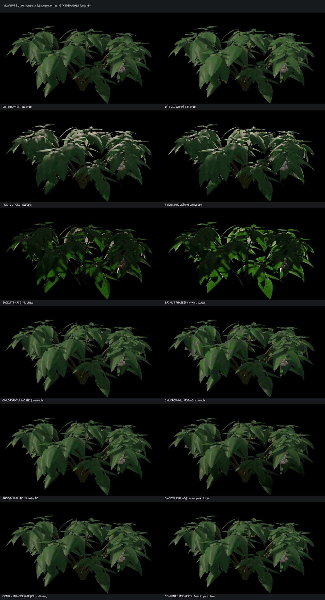

# Vivarium — unconventional foliage scattering research (18 Oct 2026)

## Intent and methodology

Experimented directly on the user-approved dirty Windows `E:\Vivarium` `main` checkout, preserving unrelated working edits. Tests were actual Godot 4.7.1 Mono Vulkan/Forward+ GPU captures on an NVIDIA GTX 1080. Changes were made in the leaf direct-light processor, the dedicated leaf shader, and the legacy vascular-flora shader; a user opt-in local material-review fixture reproduced independent tests. Capture directories under `build/foliage-explorer/` are not part of the repository.

## Candidate techniques and measured effects

All RGB mean absolute differences (MAD) below are foreground-only against the x0 capture, over 0 to 255 RGB channel values. They are **not perceptual realism scores**, physical calibrations, or performance measurements.

| Mechanism | Tested settings | Foreground MAD | Observation / selection |
|---|---|---|---|
| Wrap-Lambert diffuse mesophyll approximation | 0, 0.2, 0.65, 1.2 | 0, 0.40, 3.19, 4.82 | Mainly lightened diffuse shadows and reduced form contrast. Disabled by default, stress controls preserved. |
| UV-tangent-aligned elliptical GGX cuticle highlight | 0, 0.5, 0.85, 0.96 | 0, 0.96, 3.64, 5.22 | Strong settings create bright elongated waxy highlights; selected **0.72** on actual upper leaf blades, not woody or reed stems. |
| Viewing-angle-dependent forward scatter through blade tissue | 0, 0.5, 2, 8 | 0, 0.65, 2.41, 8.16 | Large gain looks neon green under near-antiparallel view/light; selected **1.6** to enhance backlit leaves selectively. |
| Chlorophyll-correlated pigment mottling | 0, 0.5, 1.8, 4 | 0, 0.65, 2.35, 5.33 | Strong treatment introduces implausible purple patches. **Disabled** in production, conditionally computed only for explicit visual tests. |
| Shoot-level shading using per-material ambient occlusion | 0, 0.35, 0.85, 1 | 0, 1.22, 3.52, 4.43 | Strong values crush plant interiors; selected dedicated-leaf occlusion **0.55**, previously 0.15. |

### Paired combination

On an isolated shadebell with identical geometry, camera and lights, moderate anisotropy (0.72) + forward scatter (1.6) gave **2.08 RGB MAD** on a front view and **2.97** on the backlit diagnostic. The legacy brooklace showed **2.09**, while ringreed was correctly unchanged at **0.00** because its mesh has zero flagged lamina vertices. The gains are real but modest at gameplay viewing distances.

The optimized combined treatment leaves wrap disabled, chlorophyll mottling disabled, retains the previous 1.5/1.3 blade-normal curvature, and increases dedicated-leaf ambient occlusion to 0.55. Cuticle axis comes from each blade's world-space positional and UV derivatives; degenerate UV mappings fall back to isotropic shading. The runtime render path uses shared shader code, not a separate screenshot filter.

## Verification and performance

- Complete world review under `build/foliage-explorer/world-candidate-04`: **66 actual GPU captures**, `VIVARIUM_WORLDREVIEW_OK checks=2 failed=0`, no logged shader compile errors. This validates visual-runtime compatibility, not photorealism.
- Two separate 15-second real-GPU low-camera `--perf-test` runs, simulation frozen, on the same GTX 1080 (the diagnostic `VIVARIUM_FOLIAGE_PERF_BASELINE=1` disables only new scattering/anisotropy/AO settings on newly constructed materials). Baseline: **79.3 FPS mean, 49 FPS lowest sampled second, 21.26 ms p95, 42.77 ms p99**. Candidate: **87.3 FPS mean, 59 FPS lowest sampled second, 20.73 ms p95, 39.47 ms p99**. Both return `VIVARIUM_PERF_OK checks=1 failed=0`. **The apparent candidate speedup is not claimed:** random world content, flora visibility, driver state and CPU/GC variability make these brief independent runs non-comparable for attributing a 1–2 ms material change. A fixed-seed, fixed-viewpoint, warmed-up GPU timer comparison is still needed before asserting material cost.
- Real source-test material geometry built successfully with zero warnings/errors in .NET. The inherited four form/mesh xUnit failures were unchanged in the preceding focused run; no new C# simulation behavior was intended.

## Follow-up hypotheses

The silhouette remains recognizable as foliage but the broad-world captures are still visibly artificial. The most promising next targets are coherent inter-leaf indirect light and density-aware shadowing (potentially a low-resolution per-shoot light-field bake), angularly resolved spectral transmittance from thickness maps, and geometry-aware cuticle microfacets. Avoid arbitrary emission or more overall green brightness. Recheck the 30 FPS floor in dense scenes before accepting any expensive new render path.

References: [Godot spatial shader built-ins and light processor](https://docs.godotengine.org/en/4.6/tutorials/shaders/shader_reference/spatial_shader.html). Custom `light()` accumulates irradiance and uses normalized LIGHT/VIEW directions; do not re-multiply `ALBEDO` inside `DIFFUSE_LIGHT`.

**Note on leaf marking:** after the first world/performance passes, the forward-scattering phase term was limited to actual tagged leaf membranes, suppressing unintended scattering on stems and non-leaf colonies. This late isolation is checked by the final shader/material review, but the initial performance runs predate the mask and are not precise measurements of the final tuned shader.
- Final membrane-masked candidate rerun: `build/foliage-explorer/final-world-09`, 66 actual PNG captures, `VIVARIUM_WORLDREVIEW_OK checks=2 failed=0`, no shader compilation errors found. Final material suite also passed: `build/foliage-explorer/final-material-08`.
- Final focused xUnit run on local working main: 66 passed, four existing form/geometry failures (embercrown, shadebell, isopod, creeper). They are not newly introduced by the material work.
