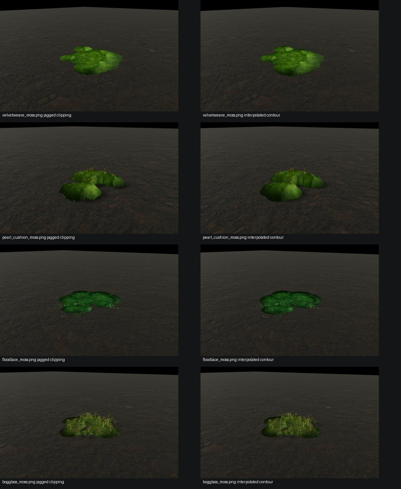
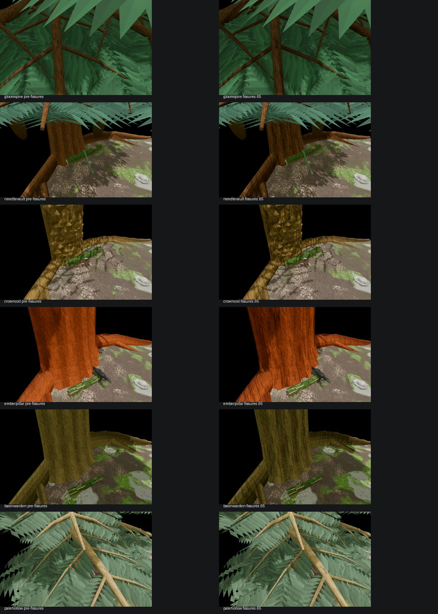

# Moss growth-point morphology, porous optics, living stems and bark

**Date:** October 18, 2026. **Engine:** Godot 4.7.1 Forward+, GTX 1080.
**Checkout:** E:\Vivarium on main; existing unrelated dirty files were preserved.

## Working design

Moss already colonizes and spreads in the Coverage ecology state at 2 cm resolution. The renderer now samples jittered growing nuclei only in currently occupied cells, derives radius from current biomass, and merges neighboring lobes. It does **not** add an ecological simulator or history. Distant moss renders through a low-height, merged canopy with recessed saddles; 4x stress adds individually authored leaflet fans, but this high-density treatment is not the default.

Individual moss geometry (velvetweave, pearl cushion, floodlace, bogglass, and generic fallback carpet) now uses continuous interpolated iso-coverage boundaries rather than manufactured circular domes or solid ellipsoids. Species-specific stems, capitula, hairpoints, sporophytes, prostrate runners, and capsules remain distinct. The clipped-triangle contour handles edges without rectangular stair steps. The discarded dense leaflet-speckle experiment can be reproduced by setting VIVARIUM_MOSS_CLONAL_SHOOTS=1; leave this disabled for normal usage. Set VIVARIUM_MOSS_CLONAL_SURFACE=0 to compare against original bases.

Shared moss_aggregate.gdshaderinc is included in the coverage and individual moss shaders. Stable plant-scale sampling widens the distribution of micro-normals and darkens protected filament cavities; it does not add emitted green light. Default optical strength is 0.75; VIVARIUM_MOSS_AGGREGATE=0 disables it. VIVARIUM_MOSS_MICRO_GROWTH=0 disables the additional visual coverage nucleus field; 1 is the default and 4 is intentionally exaggerated.

Mature bark uses shared bark_fissure.gdshaderinc in both ordinary vascular stems and the separate pilot tree shader. Longitudinal cracks follow scanned dark crevices; color, relief and occlusion agree rather than producing painted-on cracks. Young living stems instead show fine longitudinal epidermal ribs and transverse growth nodes. VIVARIUM_BARK_FISSURES=0 and VIVARIUM_LIVING_STEM=0 turn these off for comparisons. Default strengths are 0.65 for cork fissures and 0.80 for young stems; 4x settings were stress-tested.

## Real GPU capture evidence

- Botanical fixtures: build/moss-all-lab/botanical-old-shape, botanical-merged-shape and botanical-iso. Both forms have deterministic geometry, identical lighting and camera. Species include velvetweave, pearl cushion, floodlace and bogglass.
- Moss world comparison: build/moss-all-lab/baseline versus candidate; both completed 66 image world reviews with checks=2, failed=0, no shader errors. Whole-image RGB mean absolute differences on the five moss specimen scenes were 0.162–0.669/255, dominated by background; not a perceptual realism measure.
- Pilot tree preview: build/bark-stem-lab/all-baseline versus all-candidate; **six** tree species, 31 images per run, both PREVIEW_OK. Among root-side1 views, percent of pixels changed more than 10 RGB levels: Gloomspire 6.84%, Needlevault 9.32%, Crowncoil 12.74%, Emberpillar 17.90%, Basinwarden 10.14%, Palehollow 4.41%.
- Direct stems: build/bark-stem-lab/stress-01 includes 0, 0.65, 2, 4x tests and passed the material review.
- Final full-world verification: build/moss-bark-final-world includes 66 GPU PNGs, WORLDREVIEW_OK checks=2 failed=0.

## GTX 1080 performance

Paired 18-second frozen-simulation, low-camera built-in perf runs, keeping the simulation and other machinery intact. Baseline disables the new moss and bark effects; candidate uses all defaults.

| Metric | Disabled | Candidate |
|---|---:|---:|
| Mean sampled FPS | 89.2 | 93.5 |
| Lowest one-second FPS | 48 | 54 |
| Worst single frame | 154.0 ms | 150.2 ms |
| Steady draw calls | 216 | 217 |
| End VRAM | 660 MB | 661 MB |
| Harness checks | Pass | Pass |

These are **independent** runs, not fixed-camera GPU timer queries. A claimed causal shader speedup would be inappropriate. Individual-frame hitches remain well above 33.3 ms, so the test does not prove a hard floor in every frame. The 30 FPS target is satisfied only on average and by the reported per-second minima in this configuration.

## Follow-up

The moss outlines have improved markedly, but very close specimens can still look too smoothly surfaced; simply adding tiny triangles created bright green speckles. Try species-specific aggregate scattering and actual narrow gametophore shoot geometry only if supported by realistic GPU captures. Fissured bark remains visible on roots and basal trunks, and needs further inspection in side lighting at normal gameplay distance. Lichens should retain separate crustose/foliose/fruticose anatomy, not be remodeled as moss.

The ecology remains present-state-driven. No growth event journal, external seasonal forcing or hidden historical chronology was introduced.
